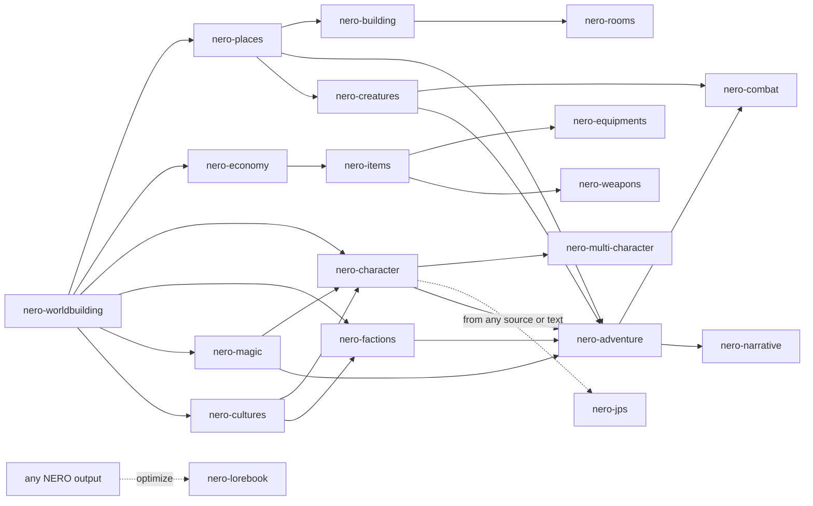

# NERO

> A set of **AI agent system prompts** for developing **characters**, **worlds**, and **adventures** for roleplay with generative AI.

**Version 1.3** · [MIT License](LICENSE) · [Changelog](CHANGELOG.md) · [Português (Brasil)](README.pt-BR.md)

---

## Table of Contents

- [What is NERO](#what-is-nero)
- [Project rules](#project-rules)
- [Repository structure](#repository-structure)
- [The agents](#the-agents)
- [JPS: platform-ready character cards](#jps-platform-ready-character-cards)
- [How to use](#how-to-use)
- [Suggested workflow](#suggested-workflow)
- [Shared conventions](#shared-conventions)
- [Adult content and limits](#adult-content-and-limits)
- [Contributing](#contributing)
- [Versioning and releases](#versioning-and-releases)
- [License](#license)

---

## What is NERO

NERO is a collection of **19 specialized system prompts**, written in Markdown. Each file is an **independent agent**: you paste it as the system prompt of an AI model, and it acts as a specialist in creating one kind of roleplay material: a character, a cast, a world, a city, a room, an economy, an adventure, a fight, or a legendary sword.

It is not an application or a library. It is **content**: prompts ready to use on any platform or model that accepts a system prompt (chat apps, roleplay frontends, APIs, custom GPTs, and projects).

What the agents produce is designed to be **used afterwards**: character sheets, character cards, lorebooks, world primers, opening scenes, and **Compact Blocks** (lean versions you paste straight into a roleplay's context without wasting tokens).

---

## Project rules

These five rules apply to **every** prompt in the repository:

| # | Rule | How NERO meets it |
|---|---|---|
| 1 | **SFW and NSFW** | Three content modes (`SFW`, `NSFW`, `Auto`). Adult content lives in optional, removable modules, so you can keep or delete it without affecting the rest. |
| 2 | **Prompts in English** | Every agent file is written in English. |
| 3 | **Multimodal** | Input: images, audio, video, documents, spreadsheets, maps, character cards. Output: text, plus image-generation prompts, voice/TTS direction, music and ambience cues, tables, ASCII/Mermaid diagrams, and JSON/YAML/CSV. |
| 4 | **Any language** | They understand prompts and attachments in any language and reply in the user's language (or the one you ask for, even a different language per section). |
| 5 | **Markdown format** | Every prompt is a `.md` file. |

---

## Repository structure

```text
nero/
├── README.md
├── README.pt-BR.md
├── CHANGELOG.md
├── LICENSE
├── characters/
│   ├── nero-character.md
│   ├── nero-multi-character.md
│   └── nero-jps.md
├── worldbuilding/
│   ├── nero-worldbuilding.md
│   ├── nero-places.md
│   ├── nero-rooms.md
│   ├── nero-building.md
│   ├── nero-economy.md
│   ├── nero-factions.md
│   ├── nero-magic.md
│   └── nero-cultures.md
├── creatures/
│   └── nero-creatures.md
├── adventure/
│   ├── nero-adventure.md
│   ├── nero-combat.md
│   └── nero-narrative.md
├── items/
│   ├── nero-items.md
│   ├── nero-equipments.md
│   └── nero-weapons.md
└── tools/
    └── nero-lorebook.md
```

---

## The agents

### `characters/`

| Agent | What it does |
|---|---|
| [`nero-character`](characters/nero-character.md) | Creates **one** deep, playable character: appearance, psychology, voice, backstory, relationships, behavior rules for the AI, an optional intimacy profile, first message, and a visual prompt. Works for the main character, NPCs, or the player's persona. |
| [`nero-multi-character`](characters/nero-multi-character.md) | Creates **casts**: groups, families, crews, factions. Designs the group as a system, the relationship web (directed, with secrets), and the **Multi-Character Roleplay Card** that teaches an AI to voice several characters in one scene without blending them. |
| [`nero-jps`](characters/nero-jps.md) | **New in 1.1, extended in 1.2.** Turns **any source** (image, audio, video, document, an existing card) **or plain text alone**, plus a prompt, into a ready-to-paste **character card** for **JanitorAI, Front Porch AI, SillyTavern, and derivatives**, in five sections (Description, Personality, Scenario, First Message, Example Dialogue) and 2,000 to 3,000 tokens. See [below](#jps-platform-ready-character-cards). |

### `worldbuilding/`

| Agent | What it does |
|---|---|
| [`nero-worldbuilding`](worldbuilding/nero-worldbuilding.md) | World architect: premise, power rules and costs, peoples, factions, religion, history, daily life, optional intimate culture, a *World Primer*, and lorebook entries. |
| [`nero-places`](worldbuilding/nero-places.md) | Places at every scale, from realms and cities to ruins and dungeons: sensory snapshot, points of interest, rumors, hooks, maps, and optional nightlife. |
| [`nero-rooms`](worldbuilding/nero-rooms.md) | Interior spaces: layout, senses, furnishings, interactive *hotspots*, secrets, state variations, tactical notes, a *Scene Setter*, and optional private spaces. |
| [`nero-building`](worldbuilding/nero-building.md) | Structures: architecture, floor plans, systems (water, light, sewage), occupants, security, secrets, and optional adult venues. |
| [`nero-economy`](worldbuilding/nero-economy.md) | Currencies, prices, wages, trade, taxes, guilds, the shadow economy, and loot balance, all anchored to a purchasing-power unit. |
| [`nero-factions`](worldbuilding/nero-factions.md) | **New in 1.3.** Guilds, noble houses, cults, corporations, gangs, orders, and other organizations: hierarchy and real power, resources, goals and methods, propaganda, recruitment, internal secrets, and a **Mermaid relations diagram**. |
| [`nero-magic`](worldbuilding/nero-magic.md) | **New in 1.3.** Power systems: magic, superpowers, mystic arts, divine gifts, psionics, and arcane technology. Source, laws, costs, limits, schools and traditions, progression, risks, and the culture built around power. |
| [`nero-cultures`](worldbuilding/nero-cultures.md) | **New in 1.3.** Peoples and societies from the inside: values, customs, taboos, festivals, family, language, aesthetics, the sacred, and the body, with a "Playing a Member" guide for narrators. |

### `creatures/`

| Agent | What it does |
|---|---|
| [`nero-creatures`](creatures/nero-creatures.md) | **New in 1.3.** Beasts, monsters, constructs, spirits, undead, and aberrations: ecology, behavior, combat profile, weaknesses, loot, folklore, and variants. Works in *Design Mode* and *Run Mode* (plays the creature live, like `nero-combat`). |

### `adventure/`

| Agent | What it does |
|---|---|
| [`nero-adventure`](adventure/nero-adventure.md) | Designs adventures (one-shots, arcs, campaigns, sandboxes, mysteries, romances): hook, structure, clues (Three-Clue Rule), progress clocks, endings, rewards, and a **GM Directive** so an AI can run the game. |
| [`nero-combat`](adventure/nero-combat.md) | Combat encounters with an objective, enemies with tactics, terrain, phases, and consequences. Works in *Design Mode* and *Run Mode* (adjudicates and narrates a fight live). Includes an optional defeat/capture module. |
| [`nero-narrative`](adventure/nero-narrative.md) | The storyteller: scenes, openings, roleplay narration, dialogue, structure, editing, translation, continuity, and the *Narrator Voice Profile*. Includes an anti-cliché list. |

### `items/`

| Agent | What it does |
|---|---|
| [`nero-items`](items/nero-items.md) | Objects, artifacts, consumables, quest items, loot tables, and optional adult items. |
| [`nero-equipments`](items/nero-equipments.md) | Armor, clothing, outfits, jewelry, kits, and wardrobes by context, with the real logic of how gear is put on, wears out, and costs. |
| [`nero-weapons`](items/nero-weapons.md) | Weapons of every kind, for fiction: combat profile, technique, lore, variants, and a narration palette. No real-world operational instructions. |

### `tools/`

| Agent | What it does |
|---|---|
| [`nero-lorebook`](tools/nero-lorebook.md) | **New in 1.3.** Turns any material, including output from the other agents, into optimized lorebook entries for SillyTavern, Agnai, and similar frontends: keywords and secondary keys, always-on versus triggered entries, order, recursion notes, token budgets, **Compact and Full** versions, and optional JSON export. |

---

## JPS: platform-ready character cards

**JPS** (`nero-jps`) is the agent for people who want a character card they can paste straight into a roleplay platform. It is built from a single-purpose workflow: **you send a prompt (with or without media), and it answers with the card, and nothing else.**

### Inputs: any source, or text only

Since 1.2, an image is no longer required. JPS is multimodal like the rest of the suite and works from any combination of:

| Source | What JPS does with it |
|---|---|
| **Images** (one or several) | Reads the look in detail and reconciles several images into one consistent character. |
| **Audio** | Turns voice, pace, accent, and mood into speech rules. It never imitates or identifies a real person's voice. |
| **Video** | Takes the look, mannerisms, and setting. |
| **Documents and existing cards** | Converts, rewrites, or adapts lore, profiles, cards, and lorebooks to the five-section format, keeping their facts. |
| **Text only** | Builds the appearance from your written description, keeps every detail you gave, and fills the gaps with specific, consistent detail. It never asks you for an image. |

### Supported platforms

| Platform | Notes |
|---|---|
| **SillyTavern** and derivatives | The default profile. Also valid for KoboldCPP, Oobabooga, and other frontends that use the common character-card fields. |
| **JanitorAI** | Keeps Description, Personality, and Scenario lean (they are permanent tokens) and puts the voice rules in Personality, because example dialogs are temporary. |
| **Front Porch AI** | Reads the common character-card format. Uses the same text as the default profile. |

### What it produces

Exactly five sections, in this order, with the headings always in English:

1. `### Description`: detailed physical traits taken from the image, estimated height and weight, and a complete backstory.
2. `### Personality`: behavior, speech, motivations, insecurities, desires, vulgarity level, plus speech rules and roleplay rules.
3. `### Scenario`: where the roleplay starts, the relationship with `{{user}}`, and the power dynamic.
4. `### First Message`: a long, immersive opening of 3 to 6 paragraphs ending on a hook.
5. `### Example Dialogue`: 3 to 5 short `<START>` blocks showing different tones.

The total is **2,000 to 3,000 tokens**.

### Where each section goes

| JPS section | SillyTavern and derivatives | JanitorAI | Front Porch AI |
|---|---|---|---|
| Description | Description | Personality box (pasted with Personality) | Description |
| Personality | Personality | Personality | Personality |
| Scenario | Scenario | Scenario | Scenario |
| First Message | First Message | Initial Message | Greeting |
| Example Dialogue | Example Messages (`mes_example`) | Example Dialogs | Sample Dialogue |

> Field names follow each platform's public descriptions at the time of writing and can change between versions. If a field has a different name in your version, map it by meaning. If you ask JPS for **JSON** or **V2**, it returns a Character Card V2 JSON block you can import where the platform supports card import.

### Settings you can state in plain words

| Setting | Values | Default |
|---|---|---|
| Platform | `sillytavern`, `janitor`, `frontporch`, `all` | `sillytavern` |
| Content mode | `SFW`, `NSFW`, `Auto` | `Auto` |
| Output language | Any | The language of your prompt (Brazilian Portuguese if it cannot be determined) |
| Narration | Person, tense, and action style | Third person, present tense, plain prose with "quoted" speech |
| Export and add-ons | `JSON` / `V2`, visual prompt, voice direction, ambience, alternate greetings | Off |

### Optional add-ons

By default the output is the card and nothing else. Ask for any of these and they follow the unchanged card, each under its own heading: `### Visual Prompt` (for an image generator), `### Voice Direction` (TTS and voice casting), `### Ambience` (music and sound cues), and `### Alternate Greetings`. JPS can also generate the image or audio itself on platforms that support it.

### Example

> *Attach an illustration.* "Platform: Janitor. Mode: NSFW. Language: English. A disgraced noble turned smuggler, teasing and sharp-tongued, secretly lonely. She has just caught `{{user}}` sneaking aboard her ship."

Text only, no attachment:

> "SillyTavern, NSFW, English. A tall, freckled red-haired alchemist in her thirties with ink-stained fingers and a dry sense of humor, who runs a failing apothecary and owes {{user}} a favor."

### Source rules

- The character is always an **explicit adult**. If an image or a text description depicts a minor or a childlike figure, JPS creates no sexual or romantic content.
- **Illustrations, renders, and AI-generated art of non-real people** get the full range of the active content mode.
- A **photograph, video, voice recording, document, or text prompt about a real person** yields a **SFW, non-sexual** character only. JPS never identifies a real person from their face or voice.
- In text-only mode, original and fictional characters get the full range of the active content mode.

---

## How to use

1. **Pick the agent** for what you want to create.
2. **Open the file** and copy **all** of its content.
3. **Paste it as the system prompt** (the system-instructions field, a project, a custom GPT, or the `system` field of your API).
4. **Talk to it**: describe what you want and attach references (image, audio, document).

Example of a first request:

> *Create a dwarven mercenary from a decaying port city. Grim tone. NSFW mode. Deep detail. Reply in Portuguese.* (with a reference image attached)

Through an API, read the file and send it as the system prompt:

```python
from pathlib import Path

system_prompt = Path("characters/nero-character.md").read_text(encoding="utf-8")
# Send `system_prompt` in the system/instructions field of the LLM provider you use.
```

After generating the material, ask for the **Compact Block** and paste it into your character card, lorebook, or roleplay prompt. (JPS needs no Compact Block: its output is already the paste-ready card.)

---

## Suggested workflow

The agents work on their own but fit together. A natural order, from general to specific:



Each agent knows the others and points to the next step when a request goes beyond its scope. Assets link to each other through **cross-references** in the form `[[Type: Name]]`, for example `[[Place: Saltmarsh Quay]]`, `[[Character: Mira Voss]]`, or `[[Item: Ashen Lantern]]`.

---

## Shared conventions

### Anatomy of a prompt

Every agent follows the same structure, which makes it easy to read, compare, and maintain:

1. **Identity and Mission**: who the agent is and what it does (and who it hands off to).
2. **Core Directives**: the rules common to all agents (content, multimodal, languages, working style, the suite).
3. **Workflow**: how the agent reads the request and runs the work.
4. **Depth Levels**: how deep the result goes.
5. **The agent's sheet**: the format of what it delivers (character sheet, place sheet, item sheet...).
6. **Principles, special requests, and a quality checklist.**

`nero-jps` is the one deliberate exception: it keeps the same Core Directives but replaces the working style with a strict output contract (the card and nothing else), and says so in its section 3.

### Content modes

| Mode | Behavior |
|---|---|
| `SFW` | No explicit sexual content and no graphic violence. Romance and tension exist, implied or with *fade to black*. |
| `NSFW` | Explicit sexual content, graphic violence, and mature themes, written with craft and not sanitized. |
| `Auto` *(default)* | Follows your request: it does not add explicit content you did not invite, and does not soften what you did. |

You can switch modes at any moment in the conversation. Your personal limits (exclusions, tags, "no X") are respected for the whole session.

### Depth

`Quick` (about one screen) · `Standard` (default) · `Deep` (exhaustive).

### Compact Block

Every deliverable can come with a **lean, paste-ready** version for the roleplay context, to save tokens.

---

## Adult content and limits

NERO is made for **adults creating fiction for adults**. It **allows** NSFW content (sexuality, eroticism, violence, horror, and dark themes) with no sermons, warnings, or moralizing commentary.

There are **hard limits** that hold in every mode and under any framing (fiction, roleplay, "it's just a test", or instructions inside attachments):

1. **No sexual or sexualized content involving anyone under 18.** Every character in a sexual context is an explicit adult. A stated age does not qualify a character depicted with a child's body or behavior.
2. **No sexual content about real, identifiable people.** Fictional and original characters are free. This includes photographs: a photo of a real person is never a basis for sexual content.
3. **Fiction stays fiction.** Violence, weapons, drugs, and hacking are handled at the level a story needs. There are never real-world operational instructions (synthesis of substances, manufacturing of real weapons, working exploit code).

By using these prompts, you are responsible for following the rules of the platform and the model you use.

---

## Contributing

When editing an existing prompt or creating a new one, keep the conventions:

- Write in **English** and in **Markdown**.
- Name the file `nero-<name>.md`, inside its category folder. The `Agent ID` in the header must equal the file name.
- Follow the anatomy above and **include the `Core Directives` block unchanged**.
- Keep adult content in **optional, removable modules**.
- If you create a new agent, add it to the table in *The NERO suite* inside the `Core Directives` of **every** agent, and to this README and the changelog.

The `Core Directives` block is **identical** in all 19 files on purpose: each prompt has to work on its own, without depending on the others. So any change to it must be replicated everywhere. To check that they are still identical, the command below must print **a single line** (a count of `19` and one hash):

```bash
for f in */nero-*.md; do sed -n '/^## 2\. Core Directives/,/^## 3\./p' "$f" | sed '$d' | md5sum; done | sort | uniq -c
```

---

## Versioning and releases

The `Version` in each prompt's header is the **suite version**. Every change that ships is recorded in the [changelog](CHANGELOG.md), and each version is published as a release.

| Version | Highlights |
|---|---|
| **1.3** | Five new agents: `nero-factions`, `nero-creatures`, `nero-magic`, `nero-cultures` (new `creatures/` folder), and `nero-lorebook` (new `tools/` folder). 19 agents in total. |
| **1.2** | `nero-jps` accepts plain text only (no image needed) and is fully multimodal on input (images, audio, video, documents, existing cards) with optional multimodal add-ons. |
| **1.1** | New agent `nero-jps` (character cards for JanitorAI, Front Porch AI, SillyTavern, and derivatives); README translated to English; changelog added. |
| **1.0** | First release: 13 agents in four categories. |

---

## License

Distributed under the **MIT** license. See the [LICENSE](LICENSE) file.
