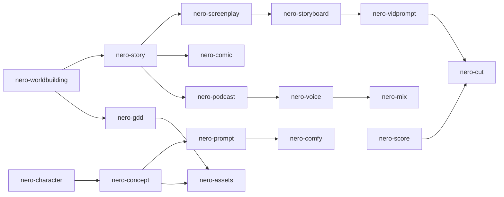
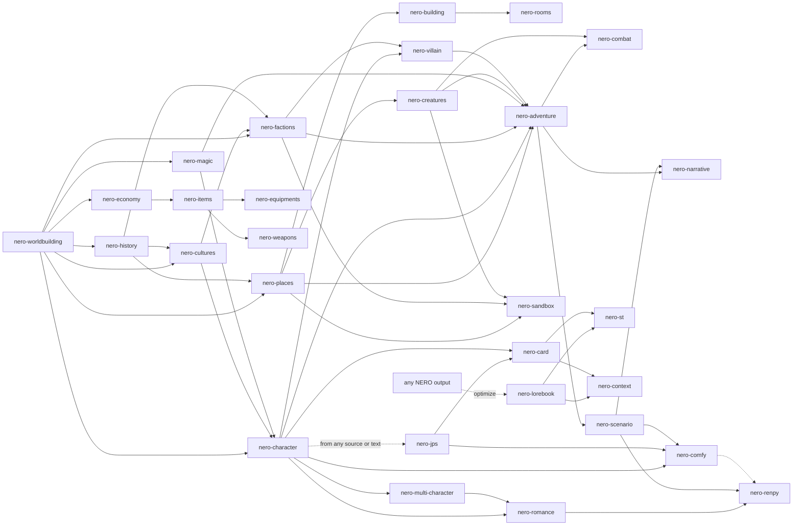
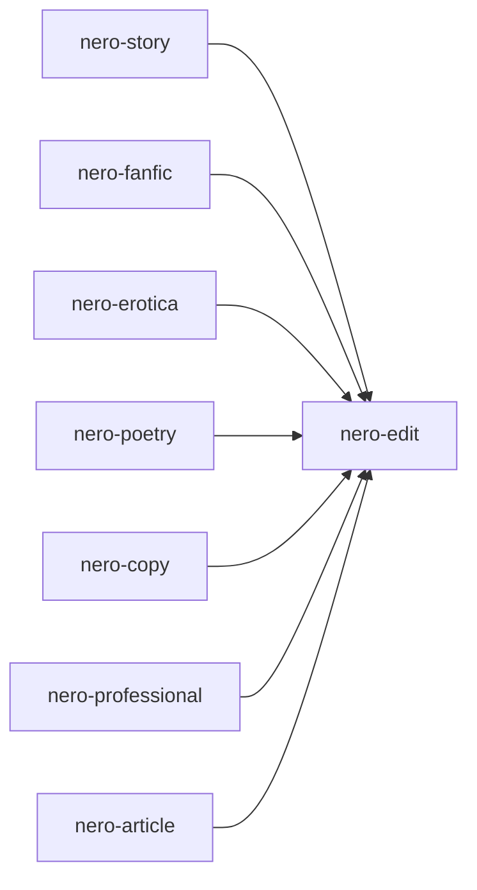
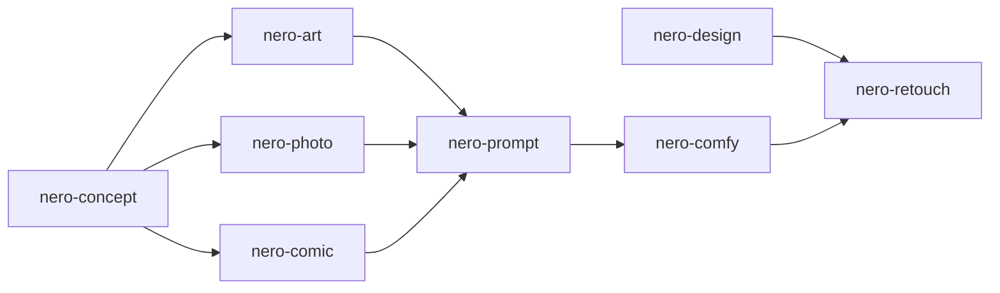
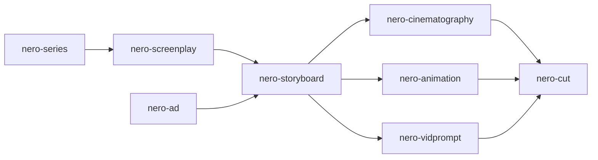
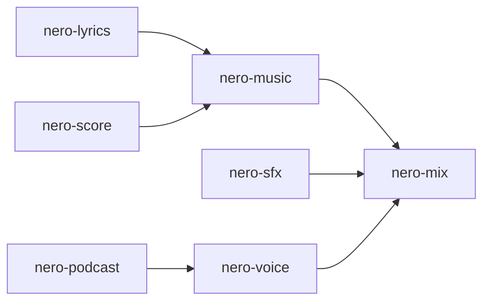
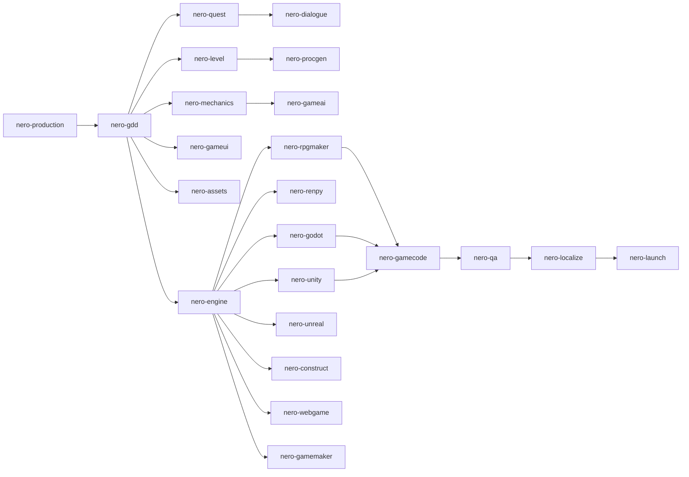

# NERO

> A suite of **AI agent system prompts** for **creative work with generative AI**: **roleplay**, **writing**, **image**, **video**, **sound**, and **games**.

**Version 2.1** · [MIT License](LICENSE) · [Changelog](CHANGELOG.md) · [Português (Brasil)](README.pt-BR.md)

---

## Table of Contents

- [What is NERO](#what-is-nero)
- [Project rules](#project-rules)
- [Repository structure](#repository-structure)
- [The agents](#the-agents)
- [JPS: platform-ready character cards](#jps-platform-ready-character-cards)
- [How to use](#how-to-use)
- [Suggested workflow](#suggested-workflow)
- [Shared conventions](#shared-conventions)
- [Adult content and limits](#adult-content-and-limits)
- [Contributing](#contributing)
- [Versioning and releases](#versioning-and-releases)
- [License](#license)

---

## What is NERO

NERO is a collection of **81 specialized system prompts**, written in Markdown, for **creative work with generative AI**. Each file is an **independent agent**: you paste it as the system prompt of an AI model, and it acts as a specialist in one craft: a character, a world, an adventure, a novel, a fan fiction, a piece of ad copy, a logo, a film script, a storyboard, a song, or a mix.

NERO began as a set of agents for **roleplay**. Since version 2.0 it has grown beyond roleplay, and it now covers six domains:

| Domain | What it covers | Agents |
|---|---|---|
| **Roleplay** | Characters, worlds, adventures, items, and the tools that connect them to roleplay platforms (SillyTavern, JanitorAI, and Front Porch AI). | 27 |
| **Writing** | Creative and professional writing: original fiction, fan fiction, erotica, poetry, copy, business and technical documents, articles, and editing. | 8 |
| **Image** | Artistic and design imagery: art direction, concept design, photography, comics, graphic design, prompts for any model, ComfyUI workflows, and retouching. | 8 |
| **Video** | Moving images: screenplays, series, advertising, storyboards, cinematography, animation, editing, and AI video generation. | 8 |
| **Sound** | Audio: music, lyrics, scoring, sound design, mixing and mastering, voice direction, and podcasts and audio drama. | 7 |
| **Games** | Game creation from concept to release: design, systems, narrative, levels, UI, AI, assets, code, QA, production, localization, publishing, and engines (RPG Maker, Ren'Py, Unreal, Godot, Unity, Construct, web, GameMaker, and more). | 23 |

It is not an application or a library. It is **content**: prompts ready to use on any platform or model that accepts a system prompt (chat apps, roleplay frontends, APIs, custom GPTs, and projects).

What the agents produce is designed to be **used afterwards**: character cards, lorebooks, manuscripts, scripts, shot lists, image and video prompts, lyrics, cue sheets, and **Compact Blocks** (lean versions you paste straight into the next tool without wasting tokens).

### Which agent should I use?

| I want to… | Use |
|---|---|
| Make a roleplay character from an image or text | [`nero-jps`](roleplay/characters/nero-jps.md) |
| Build a world, a faction, or a magic system | [`nero-worldbuilding`](roleplay/worldbuilding/nero-worldbuilding.md), [`nero-factions`](roleplay/worldbuilding/nero-factions.md), [`nero-magic`](roleplay/worldbuilding/nero-magic.md) |
| Write a short story or a novel | [`nero-story`](writing/fiction/nero-story.md) |
| Write fan fiction or erotic fiction | [`nero-fanfic`](writing/fiction/nero-fanfic.md), [`nero-erotica`](writing/fiction/nero-erotica.md) |
| Write marketing copy or a business document | [`nero-copy`](writing/professional/nero-copy.md), [`nero-professional`](writing/professional/nero-professional.md) |
| Improve a draft | [`nero-edit`](writing/editing/nero-edit.md) |
| Get a prompt for an image model | [`nero-prompt`](image/tools/nero-prompt.md), [`nero-art`](image/art/nero-art.md) |
| Design a logo or a poster | [`nero-design`](image/design/nero-design.md) |
| Write a screenplay or plan a series | [`nero-screenplay`](video/scripts/nero-screenplay.md), [`nero-series`](video/scripts/nero-series.md) |
| Plan shots or make AI video clips | [`nero-storyboard`](video/craft/nero-storyboard.md), [`nero-vidprompt`](video/tools/nero-vidprompt.md) |
| Write a song | [`nero-lyrics`](sound/music/nero-lyrics.md), [`nero-music`](sound/music/nero-music.md) |
| Design sound or plan a podcast | [`nero-sfx`](sound/production/nero-sfx.md), [`nero-podcast`](sound/production/nero-podcast.md) |
| Design a game or write a design document | [`nero-gdd`](games/design/nero-gdd.md), [`nero-mechanics`](games/design/nero-mechanics.md) |
| Build a game in RPG Maker, Ren'Py, Godot, Unity, Unreal, Construct, GameMaker, or the web | [`nero-rpgmaker`](games/engines/nero-rpgmaker.md), [`nero-renpy`](games/engines/nero-renpy.md), [`nero-godot`](games/engines/nero-godot.md), [`nero-unity`](games/engines/nero-unity.md), [`nero-unreal`](games/engines/nero-unreal.md), [`nero-construct`](games/engines/nero-construct.md), [`nero-gamemaker`](games/engines/nero-gamemaker.md), [`nero-webgame`](games/engines/nero-webgame.md) |
| Pick an engine, or ship and market a game | [`nero-engine`](games/engines/nero-engine.md), [`nero-launch`](games/production/nero-launch.md) |

---

## Project rules

These five rules apply to **every** prompt in the repository, in all six domains:

| # | Rule | How NERO meets it |
|---|---|---|
| 1 | **SFW and NSFW** | Three content modes (`SFW`, `NSFW`, `Auto`). Adult content lives in optional, removable modules, so you can keep or delete it without affecting the rest. |
| 2 | **Prompts in English** | Every agent file is written in English. |
| 3 | **Multimodal** | Input: images, audio, video, documents, spreadsheets, maps, character cards. Output: text, plus image-generation prompts, voice/TTS direction, music and ambience cues, tables, ASCII/Mermaid diagrams, and JSON/YAML/CSV. |
| 4 | **Any language** | They understand prompts and attachments in any language and reply in the user's language (or the one you ask for, even a different language per section). |
| 5 | **Markdown format** | Every prompt is a `.md` file. |

---

## Repository structure

Agents live in `domain/category/` folders. Each file's header lists its `Domain` and `Category`, which match its folder.

```text
nero/
├── README.md
├── README.pt-BR.md
├── CHANGELOG.md
├── LICENSE
├── roleplay/
│   ├── characters/
│   │   ├── nero-character.md
│   │   ├── nero-multi-character.md
│   │   ├── nero-jps.md
│   │   ├── nero-romance.md
│   │   └── nero-villain.md
│   ├── worldbuilding/
│   │   ├── nero-worldbuilding.md
│   │   ├── nero-places.md
│   │   ├── nero-rooms.md
│   │   ├── nero-building.md
│   │   ├── nero-economy.md
│   │   ├── nero-factions.md
│   │   ├── nero-magic.md
│   │   ├── nero-cultures.md
│   │   └── nero-history.md
│   ├── creatures/
│   │   └── nero-creatures.md
│   ├── adventure/
│   │   ├── nero-adventure.md
│   │   ├── nero-combat.md
│   │   ├── nero-narrative.md
│   │   ├── nero-scenario.md
│   │   └── nero-sandbox.md
│   ├── items/
│   │   ├── nero-items.md
│   │   ├── nero-equipments.md
│   │   └── nero-weapons.md
│   └── tools/
│       ├── nero-lorebook.md
│       ├── nero-st.md
│       ├── nero-card.md
│       └── nero-context.md
├── writing/
│   ├── fiction/
│   │   ├── nero-story.md
│   │   ├── nero-fanfic.md
│   │   ├── nero-erotica.md
│   │   └── nero-poetry.md
│   ├── professional/
│   │   ├── nero-copy.md
│   │   ├── nero-professional.md
│   │   └── nero-article.md
│   └── editing/
│       └── nero-edit.md
├── image/
│   ├── art/
│   │   ├── nero-art.md
│   │   ├── nero-concept.md
│   │   ├── nero-photo.md
│   │   └── nero-comic.md
│   ├── design/
│   │   └── nero-design.md
│   └── tools/
│       ├── nero-prompt.md
│       ├── nero-comfy.md
│       └── nero-retouch.md
├── video/
│   ├── scripts/
│   │   ├── nero-screenplay.md
│   │   ├── nero-series.md
│   │   └── nero-ad.md
│   ├── craft/
│   │   ├── nero-storyboard.md
│   │   ├── nero-cinematography.md
│   │   ├── nero-animation.md
│   │   └── nero-cut.md
│   └── tools/
│       └── nero-vidprompt.md
├── sound/
│   ├── music/
│   │   ├── nero-music.md
│   │   ├── nero-lyrics.md
│   │   └── nero-score.md
│   └── production/
│       ├── nero-sfx.md
│       ├── nero-mix.md
│       ├── nero-voice.md
│       └── nero-podcast.md
└── games/
    ├── design/
    │   ├── nero-gdd.md
    │   ├── nero-mechanics.md
    │   ├── nero-quest.md
    │   ├── nero-dialogue.md
    │   ├── nero-level.md
    │   ├── nero-gameui.md
    │   └── nero-procgen.md
    ├── production/
    │   ├── nero-gameai.md
    │   ├── nero-assets.md
    │   ├── nero-gamecode.md
    │   ├── nero-qa.md
    │   ├── nero-production.md
    │   ├── nero-localize.md
    │   └── nero-launch.md
    └── engines/
        ├── nero-rpgmaker.md
        ├── nero-renpy.md
        ├── nero-unreal.md
        ├── nero-godot.md
        ├── nero-unity.md
        ├── nero-construct.md
        ├── nero-webgame.md
        ├── nero-gamemaker.md
        └── nero-engine.md
```

---

## The agents

Every agent follows the same structure (see [Shared conventions](#shared-conventions)). Agents hand off to one another across domains.

### Roleplay

_Characters, worlds, adventures, items, and the tools that connect them to roleplay platforms (SillyTavern, JanitorAI, and Front Porch AI)._

#### `roleplay/characters/`

| Agent | What it does |
|---|---|
| [`nero-character`](roleplay/characters/nero-character.md) | Creates **one** deep, playable character: appearance, psychology, voice, backstory, relationships, behavior rules for the AI, an optional intimacy profile, first message, and a visual prompt. Works for the main character, NPCs, or the player's persona. |
| [`nero-multi-character`](roleplay/characters/nero-multi-character.md) | Creates **casts**: groups, families, crews, factions. Designs the group as a system, the relationship web (directed, with secrets), and the **Multi-Character Roleplay Card** that teaches an AI to voice several characters in one scene without blending them. |
| [`nero-jps`](roleplay/characters/nero-jps.md) | Turns **any source** (image, audio, video, document, an existing card) **or plain text alone**, plus a prompt, into a ready-to-paste **character card** for **JanitorAI, Front Porch AI, SillyTavern, and derivatives**, in five sections (Description, Personality, Scenario, First Message, Example Dialogue) and 2,000 to 3,000 tokens. See [below](#jps-platform-ready-character-cards). |
| [`nero-romance`](roleplay/characters/nero-romance.md) | The bond between characters: chemistry, power map, tension engine, arc beats, a 0 to 5 heat track, and modules for slow-burn, enemies-to-lovers, forbidden, toxic, redemptive, and found-family bonds. Optional **pair-level intimacy module** (compatibility, negotiation, escalation, aftermath) that does not repeat `nero-character`. |
| [`nero-villain`](roleplay/characters/nero-villain.md) | Antagonists with depth: motivation and what they are right about, methods, resources, a personal relationship with the protagonist, a **proactive phased plan** with clocks and a move table, and redemption, fall, or no-redemption arcs. |

#### `roleplay/worldbuilding/`

| Agent | What it does |
|---|---|
| [`nero-worldbuilding`](roleplay/worldbuilding/nero-worldbuilding.md) | World architect: premise, power rules and costs, peoples, factions, religion, history, daily life, optional intimate culture, a *World Primer*, and lorebook entries. |
| [`nero-places`](roleplay/worldbuilding/nero-places.md) | Places at every scale, from realms and cities to ruins and dungeons: sensory snapshot, points of interest, rumors, hooks, maps, and optional nightlife. |
| [`nero-rooms`](roleplay/worldbuilding/nero-rooms.md) | Interior spaces: layout, senses, furnishings, interactive *hotspots*, secrets, state variations, tactical notes, a *Scene Setter*, and optional private spaces. |
| [`nero-building`](roleplay/worldbuilding/nero-building.md) | Structures: architecture, floor plans, systems (water, light, sewage), occupants, security, secrets, and optional adult venues. |
| [`nero-economy`](roleplay/worldbuilding/nero-economy.md) | Currencies, prices, wages, trade, taxes, guilds, the shadow economy, and loot balance, all anchored to a purchasing-power unit. |
| [`nero-factions`](roleplay/worldbuilding/nero-factions.md) | Guilds, noble houses, cults, corporations, gangs, orders, and other organizations: hierarchy and real power, resources, goals and methods, propaganda, recruitment, internal secrets, and a **Mermaid relations diagram**. |
| [`nero-magic`](roleplay/worldbuilding/nero-magic.md) | Power systems: magic, superpowers, mystic arts, divine gifts, psionics, and arcane technology. Source, laws, costs, limits, schools and traditions, progression, risks, and the culture built around power. |
| [`nero-cultures`](roleplay/worldbuilding/nero-cultures.md) | Peoples and societies from the inside: values, customs, taboos, festivals, family, language, aesthetics, the sacred, and the body, with a "Playing a Member" guide for narrators. |
| [`nero-history`](roleplay/worldbuilding/nero-history.md) | Timelines and eras, shaping events with causes and long-term consequences, **official history versus truth**, legacies, generational memory, lost knowledge, and links to characters, factions, and places, with a Mermaid causal-chain diagram. |

#### `roleplay/creatures/`

| Agent | What it does |
|---|---|
| [`nero-creatures`](roleplay/creatures/nero-creatures.md) | Beasts, monsters, constructs, spirits, undead, and aberrations: ecology, behavior, combat profile, weaknesses, loot, folklore, and variants. Works in *Design Mode* and *Run Mode* (plays the creature live, like `nero-combat`). |

#### `roleplay/adventure/`

| Agent | What it does |
|---|---|
| [`nero-adventure`](roleplay/adventure/nero-adventure.md) | Designs adventures (one-shots, arcs, campaigns, sandboxes, mysteries, romances): hook, structure, clues (Three-Clue Rule), progress clocks, endings, rewards, and a **GM Directive** so an AI can run the game. |
| [`nero-combat`](roleplay/adventure/nero-combat.md) | Combat encounters with an objective, enemies with tactics, terrain, phases, and consequences. Works in *Design Mode* and *Run Mode* (adjudicates and narrates a fight live). Includes an optional defeat/capture module. |
| [`nero-narrative`](roleplay/adventure/nero-narrative.md) | The storyteller: scenes, openings, roleplay narration, dialogue, structure, editing, translation, continuity, and the *Narrator Voice Profile*. Includes an anti-cliché list. |
| [`nero-scenario`](roleplay/adventure/nero-scenario.md) | Immersive, ready-to-paste **openings**: first messages, cold opens, situational hooks, and Scenario lines, built from anchor, situation, pressure, presence, and an open door that never decides for the user. |
| [`nero-sandbox`](roleplay/adventure/nero-sandbox.md) | Open-world and **hexcrawl** packs: hex maps and keys, points of interest, rumor tables, travel rules, random encounter and event tables, exploration clocks, faction turns, and an Exploration Directive so an AI can run the world. |

#### `roleplay/items/`

| Agent | What it does |
|---|---|
| [`nero-items`](roleplay/items/nero-items.md) | Objects, artifacts, consumables, quest items, loot tables, and optional adult items. |
| [`nero-equipments`](roleplay/items/nero-equipments.md) | Armor, clothing, outfits, jewelry, kits, and wardrobes by context, with the real logic of how gear is put on, wears out, and costs. |
| [`nero-weapons`](roleplay/items/nero-weapons.md) | Weapons of every kind, for fiction: combat profile, technique, lore, variants, and a narration palette. No real-world operational instructions. |

#### `roleplay/tools/`

| Agent | What it does |
|---|---|
| [`nero-lorebook`](roleplay/tools/nero-lorebook.md) | Turns any material, including output from the other agents, into optimized lorebook entries for SillyTavern, Agnai, and similar frontends: keywords and secondary keys, always-on versus triggered entries, order, recursion notes, token budgets, **Compact and Full** versions, and optional JSON export. |
| [`nero-st`](roleplay/tools/nero-st.md) | The SillyTavern engineer: World Info settings (keys, regex, depth, probability, order, constant, recursion), Regex Scripts, Quick Replies, Author's Note, Character Card V2/V3 fields, generation presets, and context-management strategy. Complements `nero-lorebook`, which writes the entry content. |
| [`nero-card`](roleplay/tools/nero-card.md) | Converts and optimizes character cards across **SillyTavern, JanitorAI, Front Porch AI, Agnai, RisuAI**, and derivatives, from any source (NERO sheet, text, image, existing card). Per-field token budgets, platform best practices, V2 and V3 support, and a lint pass. |
| [`nero-context`](roleplay/tools/nero-context.md) | Context compression and prioritization: turns any NERO output into high-density versions for **4k, 8k, 16k, and 32k+** windows, with priority tiers, a Loss Report, a consistency check, and a rolling-summary template. |

### Writing

_Creative and professional writing: original fiction, fan fiction, erotica, poetry, copy, business and technical documents, articles, and editing._

#### `writing/fiction/`

| Agent | What it does |
|---|---|
| [`nero-story`](writing/fiction/nero-story.md) | **New in 2.0.** Original fiction from idea to draft: concept, characters, structure, scene cards, a voice and style guide, and drafted chapters, for short stories, novellas, novels, and serials. |
| [`nero-fanfic`](writing/fiction/nero-fanfic.md) | **New in 2.0.** Fan fiction with a canon audit, characterization checks, AU and trope types, an archive package (rating, tags, warnings), and a firm originality rule. Sexual content only with characters who are adults in canon. |
| [`nero-erotica`](writing/fiction/nero-erotica.md) | **New in 2.0.** Erotic fiction for adults: heat levels, desire logic, consent as craft, sensory design, dynamics and tropes, content notes, and tags, within firm hard limits. |
| [`nero-poetry`](writing/fiction/nero-poetry.md) | **New in 2.0.** Poems and verse in any language: fixed forms and free verse, image and sound, line breaks, sequences, translation, and spoken word. |

#### `writing/professional/`

| Agent | What it does |
|---|---|
| [`nero-copy`](writing/professional/nero-copy.md) | **New in 2.0.** Marketing and advertising copy: briefs, frameworks, channel deliverables, brand voice, A/B variants, transcreation, and honesty and compliance rules. |
| [`nero-professional`](writing/professional/nero-professional.md) | **New in 2.0.** Business, technical, and academic writing: emails, reports, proposals, documentation, CVs, grants, and speeches, with placeholders instead of invented facts. |
| [`nero-article`](writing/professional/nero-article.md) | **New in 2.0.** Articles, essays, newsletters, features, reviews, and memoir: thesis, structure, voice, headline options, and a fact-check list. |

#### `writing/editing/`

| Agent | What it does |
|---|---|
| [`nero-edit`](writing/editing/nero-edit.md) | **New in 2.0.** The editor: developmental, line, copy, and proofreading passes, severity-ranked critique, voice-preserving rewrites, and continuity checks, for any kind of writing. |

### Image

_Artistic and design imagery: art direction, concept design, photography, comics, graphic design, prompts for any model, ComfyUI workflows, and retouching._

#### `image/art/`

| Agent | What it does |
|---|---|
| [`nero-art`](image/art/nero-art.md) | **New in 2.0.** Art direction for artistic images: concept, style traits, composition, light, color, prompts, variations, series bibles, and artist briefs. |
| [`nero-concept`](image/art/nero-concept.md) | **New in 2.0.** Concept design for characters, creatures, props, vehicles, and environments: silhouettes, shape language, color, variations, and design sheets. |
| [`nero-photo`](image/art/nero-photo.md) | **New in 2.0.** Photography direction and photoreal prompts: lighting, lenses, composition, shot lists, post-processing, and consent and synthetic-media rules. |
| [`nero-comic`](image/art/nero-comic.md) | **New in 2.0.** Comics, manga, and webtoons: page and panel scripts, pacing, lettering, character locks, and prompts for consistent panels. |

#### `image/design/`

| Agent | What it does |
|---|---|
| [`nero-design`](image/design/nero-design.md) | **New in 2.0.** Graphic and brand design: logos, identity systems, posters, packaging, layouts, typography, color with contrast checks, and production specs. |

#### `image/tools/`

| Agent | What it does |
|---|---|
| [`nero-prompt`](image/tools/nero-prompt.md) | **New in 2.0.** Image prompt engineering for any model family: anatomy, syntax by family, parameters, iteration, consistency locks, and debugging. |
| [`nero-comfy`](image/tools/nero-comfy.md) | ComfyUI and Stable Diffusion pipelines: prompt packages by model family, a reusable **Character Lock** for consistency, workflow structure (LoRAs by role, ControlNet, IP-Adapter, upscale, detailer), and variation batches, for SFW and NSFW. Built-in safety rules: adults only, no real-person likeness in sexual content. |
| [`nero-retouch`](image/tools/nero-retouch.md) | **New in 2.0.** Image editing and restoration: inpainting, outpainting, upscaling, compositing, grading, and honest retouching, with integrity rules. |

### Video

_Moving images: screenplays, series, advertising, storyboards, cinematography, animation, editing, and AI video generation._

#### `video/scripts/`

| Agent | What it does |
|---|---|
| [`nero-screenplay`](video/scripts/nero-screenplay.md) | **New in 2.0.** Scripts for film, TV, shorts, and animation: logline, treatment, beat sheet, scene list, and formatted pages, with feasibility notes. |
| [`nero-series`](video/scripts/nero-series.md) | **New in 2.0.** Series bibles: the engine, characters and arcs, seasons, episode guides, pilot design, and long-form planning. |
| [`nero-ad`](video/scripts/nero-ad.md) | **New in 2.0.** Advertising and promotional video: insight, big idea, hook-first scripts, shot plans, cutdowns, testing, and compliance rules. |

#### `video/craft/`

| Agent | What it does |
|---|---|
| [`nero-storyboard`](video/craft/nero-storyboard.md) | **New in 2.0.** Shot lists and storyboards: shot vocabulary, coverage, blocking, continuity, timing, and per-frame prompts. |
| [`nero-cinematography`](video/craft/nero-cinematography.md) | **New in 2.0.** The look of moving images: camera, lenses, lighting, color script, movement, and shot design for real shoots, animation, and AI video. |
| [`nero-animation`](video/craft/nero-animation.md) | **New in 2.0.** Animation planning for 2D, 3D, stop motion, motion graphics, games, and AI-assisted work: style bible, acting, timing, shot breakdown, and pipeline. |
| [`nero-cut`](video/craft/nero-cut.md) | **New in 2.0.** Video editing and post planning: pacing, edit decision lists, transitions, sound and color plans, captions and SRT, trailers, and deliverables. |

#### `video/tools/`

| Agent | What it does |
|---|---|
| [`nero-vidprompt`](video/tools/nero-vidprompt.md) | **New in 2.0.** AI video generation: clip prompts, camera and motion language, keyframes, consistency, pipelines, and the real limits of the tools. |

### Sound

_Audio: music, lyrics, scoring, sound design, mixing and mastering, voice direction, and podcasts and audio drama._

#### `sound/music/`

| Agent | What it does |
|---|---|
| [`nero-music`](sound/music/nero-music.md) | **New in 2.0.** Music composition and production briefs: structure, harmony, melody guidance, arrangement, production plans, and prompts for AI music generators. |
| [`nero-lyrics`](sound/music/nero-lyrics.md) | **New in 2.0.** Songwriting and lyrics: hooks, structure, rhyme and meter, prosody and singability, rap flow, and multilingual writing. |
| [`nero-score`](sound/music/nero-score.md) | **New in 2.0.** Scoring for film, games, visual novels, and play: spotting, themes and leitmotifs, palettes, cue sheets, and adaptive music design. |

#### `sound/production/`

| Agent | What it does |
|---|---|
| [`nero-sfx`](sound/production/nero-sfx.md) | **New in 2.0.** Sound design: layered effects, foley, ambiences, creature, magic, and UI sounds, generator prompts, and implementation notes. |
| [`nero-mix`](sound/production/nero-mix.md) | **New in 2.0.** Mixing, mastering, and audio post: diagnosis by symptom, signal chains, dialogue cleanup, loudness, and delivery. |
| [`nero-voice`](sound/production/nero-voice.md) | **New in 2.0.** Voice and performance direction: voice profiles, casting briefs, narration, TTS and voice design, and pronunciation, with strict no-cloning rules. |
| [`nero-podcast`](sound/production/nero-podcast.md) | **New in 2.0.** Podcasts, audio drama, radio, and audiobooks: show bibles, episode structures, scripts with sound cues, interviews, and show notes. |

### Games

_Game creation from concept to release: design, systems, narrative, levels, UI, AI, assets, code, QA, production, localization, publishing, and engines._

#### `games/design/`

| Agent | What it does |
|---|---|
| [`nero-gdd`](games/design/nero-gdd.md) | **New in 2.1.** Game concept, pitch, design pillars, core loop, scope tiers (MVP, vertical slice), risk register, and a full Game Design Document, with engine fit notes. |
| [`nero-mechanics`](games/design/nero-mechanics.md) | **New in 2.1.** Systems design and balance: rules, formulas, progression curves, economy flows, crafting, difficulty, tuning tables, and test cases, with engine implementation notes. |
| [`nero-quest`](games/design/nero-quest.md) | **New in 2.1.** Game narrative and quest design: structures, quest specs with stable IDs and states, choice and consequence ledgers, lore delivery, and pacing. |
| [`nero-dialogue`](games/design/nero-dialogue.md) | **New in 2.1.** In-game dialogue: conversation graphs, barks, skill checks, voice-over scripts, and importable formats (Ren'Py, Ink, Yarn Spinner, Twine, JSON, CSV, RPG Maker), localization-ready. |
| [`nero-level`](games/design/nero-level.md) | **New in 2.1.** Level and space design: flow, beats, metrics, encounters, secrets, genre modules, and build notes for each engine's map tools. |
| [`nero-gameui`](games/design/nero-gameui.md) | **New in 2.1.** Game UI and UX: HUDs, menus, inventories, input for mouse, gamepad, and touch, states and feedback, accessibility, and per-engine UI toolkits. |
| [`nero-procgen`](games/design/nero-procgen.md) | **New in 2.1.** Procedural content generation: generator specs for dungeons, worlds, loot, quests, and names, with constraints, validation, seeds, and pseudocode. |

#### `games/production/`

| Agent | What it does |
|---|---|
| [`nero-gameai`](games/production/nero-gameai.md) | **New in 2.1.** Enemy and NPC behavior: state machines, behavior trees, utility AI, perception, pathfinding, boss patterns, fairness tuning, and constrained LLM-NPC guidance. |
| [`nero-assets`](games/production/nero-assets.md) | **New in 2.1.** Art and audio asset planning: art bible, asset lists, specs and naming, sprite sheets and tilesets, license tracking, AI-asset workflows, and engine import settings. |
| [`nero-gamecode`](games/production/nero-gamecode.md) | **New in 2.1.** Engine-agnostic game programming: architecture and patterns, game loops, state machines, saves, input, networking basics, performance, and project hygiene. |
| [`nero-qa`](games/production/nero-qa.md) | **New in 2.1.** Game testing: risk-based plans, test cases, playtest protocols, bug-report templates, soft-lock and save checks, compatibility, and release readiness. |
| [`nero-production`](games/production/nero-production.md) | **New in 2.1.** Scope, roadmap, milestones, work breakdown, team plans, risk registers, budgets, game-jam plans, and post-mortems. |
| [`nero-localize`](games/production/nero-localize.md) | **New in 2.1.** Localization and internationalization: i18n readiness, string tables with context, glossaries, text expansion, fonts, in-context QA, and per-engine tooling. |
| [`nero-launch`](games/production/nero-launch.md) | **New in 2.1.** Publishing and marketing: positioning, store pages, trailers and press kits, pricing and ethical monetization, release checklists, and post-launch plans. |

#### `games/engines/`

| Agent | What it does |
|---|---|
| [`nero-rpgmaker`](games/engines/nero-rpgmaker.md) | **New in 2.1.** **RPG Maker, all versions** (95, 2000, 2003, XP, VX, VX Ace, MV, MZ, Unite, and console editions): database, eventing, MZ and MV plugins, Ruby scripts, battle systems, specs, and deployment. |
| [`nero-renpy`](games/engines/nero-renpy.md) | Adapts characters, scenarios, relationships, and arcs into **Ren'Py** projects: labels, choice menus, flags and variables, transitions, CG declarations, a route map, an asset manifest, and age-gated mature scenes with SFW fallbacks. |
| [`nero-unreal`](games/engines/nero-unreal.md) | **New in 2.1.** Unreal Engine: gameplay framework, Blueprints and C++, Enhanced Input, Gameplay Ability System, UMG, AI, Niagara, Sequencer, World Partition, naming conventions, and packaging. |
| [`nero-godot`](games/engines/nero-godot.md) | **New in 2.1.** Godot 4 (with 3.x notes): scenes and nodes, typed GDScript and C#, signals, resources, 2D and 3D, shaders, export, and common pitfalls. |
| [`nero-unity`](games/engines/nero-unity.md) | **New in 2.1.** Unity: C# scripting, prefabs, ScriptableObjects, Input System, UI Toolkit and uGUI, render pipelines, Addressables, profiling, and builds. |
| [`nero-construct`](games/engines/nero-construct.md) | **New in 2.1.** Construct: layouts, object types, families, behaviors, exact event-sheet notation, JavaScript scripting, addons, performance, and export. |
| [`nero-webgame`](games/engines/nero-webgame.md) | **New in 2.1.** Web and HTML5 games: stack choice (vanilla Canvas, Phaser, PixiJS, Three.js, Babylon.js, and more), fixed-timestep loops, input, audio policies, saving, PWA, and deployment (itch.io and wrappers). |
| [`nero-gamemaker`](games/engines/nero-gamemaker.md) | **New in 2.1.** GameMaker: GML, objects and events, rooms and layers, collisions, state machines, structs, sequences, shaders, and exports. |
| [`nero-engine`](games/engines/nero-engine.md) | **New in 2.1.** Engine selection, comparison, and migration, plus quickstarts for every other engine and platform (LÖVE, Defold, Pygame, Bevy, MonoGame, Roblox, UEFN, Twine, Ink, fantasy consoles, and more). |

---

## JPS: platform-ready character cards

**JPS** (`nero-jps`) is the agent for people who want a character card they can paste straight into a roleplay platform. It is built from a single-purpose workflow: **you send a prompt (with or without media), and it answers with the card, and nothing else.**

### Inputs: any source, or text only

Since 1.2, an image is no longer required. JPS is multimodal like the rest of the suite and works from any combination of:

| Source | What JPS does with it |
|---|---|
| **Images** (one or several) | Reads the look in detail and reconciles several images into one consistent character. |
| **Audio** | Turns voice, pace, accent, and mood into speech rules. It never imitates or identifies a real person's voice. |
| **Video** | Takes the look, mannerisms, and setting. |
| **Documents and existing cards** | Converts, rewrites, or adapts lore, profiles, cards, and lorebooks to the five-section format, keeping their facts. |
| **Text only** | Builds the appearance from your written description, keeps every detail you gave, and fills the gaps with specific, consistent detail. It never asks you for an image. |

### Supported platforms

| Platform | Notes |
|---|---|
| **SillyTavern** and derivatives | The default profile. Also valid for KoboldCPP, Oobabooga, and other frontends that use the common character-card fields. |
| **JanitorAI** | Keeps Description, Personality, and Scenario lean (they are permanent tokens) and puts the voice rules in Personality, because example dialogs are temporary. |
| **Front Porch AI** | Reads the common character-card format. Uses the same text as the default profile. |

### What it produces

Exactly five sections, in this order, with the headings always in English:

1. `### Description`: detailed physical traits taken from the image, estimated height and weight, and a complete backstory.
2. `### Personality`: behavior, speech, motivations, insecurities, desires, vulgarity level, plus speech rules and roleplay rules.
3. `### Scenario`: where the roleplay starts, the relationship with `{{user}}`, and the power dynamic.
4. `### First Message`: a long, immersive opening of 3 to 6 paragraphs ending on a hook.
5. `### Example Dialogue`: 3 to 5 short `<START>` blocks showing different tones.

The total is **2,000 to 3,000 tokens**.

### Where each section goes

| JPS section | SillyTavern and derivatives | JanitorAI | Front Porch AI |
|---|---|---|---|
| Description | Description | Personality box (pasted with Personality) | Description |
| Personality | Personality | Personality | Personality |
| Scenario | Scenario | Scenario | Scenario |
| First Message | First Message | Initial Message | Greeting |
| Example Dialogue | Example Messages (`mes_example`) | Example Dialogs | Sample Dialogue |

> Field names follow each platform's public descriptions at the time of writing and can change between versions. If a field has a different name in your version, map it by meaning. If you ask JPS for **JSON** or **V2**, it returns a Character Card V2 JSON block you can import where the platform supports card import.

### Settings you can state in plain words

| Setting | Values | Default |
|---|---|---|
| Platform | `sillytavern`, `janitor`, `frontporch`, `all` | `sillytavern` |
| Content mode | `SFW`, `NSFW`, `Auto` | `Auto` |
| Output language | Any | The language of your prompt (Brazilian Portuguese if it cannot be determined) |
| Narration | Person, tense, and action style | Third person, present tense, plain prose with "quoted" speech |
| Export and add-ons | `JSON` / `V2`, visual prompt, voice direction, ambience, alternate greetings | Off |

### Optional add-ons

By default the output is the card and nothing else. Ask for any of these and they follow the unchanged card, each under its own heading: `### Visual Prompt` (for an image generator), `### Voice Direction` (TTS and voice casting), `### Ambience` (music and sound cues), and `### Alternate Greetings`. JPS can also generate the image or audio itself on platforms that support it.

### Example

> *Attach an illustration.* "Platform: Janitor. Mode: NSFW. Language: English. A disgraced noble turned smuggler, teasing and sharp-tongued, secretly lonely. She has just caught `{{user}}` sneaking aboard her ship."

Text only, no attachment:

> "SillyTavern, NSFW, English. A tall, freckled red-haired alchemist in her thirties with ink-stained fingers and a dry sense of humor, who runs a failing apothecary and owes {{user}} a favor."

### Source rules

- The character is always an **explicit adult**. If an image or a text description depicts a minor or a childlike figure, JPS creates no sexual or romantic content.
- **Illustrations, renders, and AI-generated art of non-real people** get the full range of the active content mode.
- A **photograph, video, voice recording, document, or text prompt about a real person** yields a **SFW, non-sexual** character only. JPS never identifies a real person from their face or voice.
- In text-only mode, original and fictional characters get the full range of the active content mode.

---

## How to use

1. **Pick the agent** for what you want to create.
2. **Open the file** and copy **all** of its content.
3. **Paste it as the system prompt** (the system-instructions field, a project, a custom GPT, or the `system` field of your API).
4. **Talk to it**: describe what you want and attach references (image, audio, document).

Example of a first request:

> *Create a dwarven mercenary from a decaying port city. Grim tone. NSFW mode. Deep detail. Reply in Portuguese.* (with a reference image attached)

Through an API, read the file and send it as the system prompt:

```python
from pathlib import Path

system_prompt = Path("roleplay/characters/nero-character.md").read_text(encoding="utf-8")
# Send `system_prompt` in the system/instructions field of the LLM provider you use.
```

After generating the material, ask for the **Compact Block** and paste it into your character card, lorebook, or roleplay prompt. (JPS needs no Compact Block: its output is already the paste-ready card.)

---

## Suggested workflow

The agents work on their own but fit together. Use them alone, or chain them across domains.

### Across domains



### Roleplay
The agents work on their own but fit together. A natural order, from general to specific:



Each agent knows the others and points to the next step when a request goes beyond its scope. Assets link to each other through **cross-references** in the form `[[Type: Name]]`, for example `[[Place: Saltmarsh Quay]]`, `[[Character: Mira Voss]]`, or `[[Item: Ashen Lantern]]`.

---


### Writing



### Image



### Video



### Sound



### Games



---

## Shared conventions

### Anatomy of a prompt

Every agent follows the same structure, which makes it easy to read, compare, and maintain. The header lists the agent's `Domain`, `Category`, and `Version`:

1. **Identity and Mission**: who the agent is and what it does (and who it hands off to).
2. **Core Directives**: the rules common to all agents (content, multimodal, languages, working style, the suite).
3. **Workflow**: how the agent reads the request and runs the work.
4. **Depth Levels**: how deep the result goes.
5. **The agent's sheet**: the format of what it delivers (character sheet, place sheet, item sheet...).
6. **Principles, special requests, and a quality checklist.**

`nero-jps` is the one deliberate exception: it keeps the same Core Directives but replaces the working style with a strict output contract (the card and nothing else), and says so in its section 3.

### Content modes

| Mode | Behavior |
|---|---|
| `SFW` | No explicit sexual content and no graphic violence. Romance and tension exist, implied or with *fade to black*. |
| `NSFW` | Explicit sexual content, graphic violence, and mature themes, written with craft and not sanitized. |
| `Auto` *(default)* | Follows your request: it does not add explicit content you did not invite, and does not soften what you did. |

You can switch modes at any moment in the conversation. Your personal limits (exclusions, tags, "no X") are respected for the whole session.

### Depth

`Quick` (about one screen) · `Standard` (default) · `Deep` (exhaustive).

### Compact Block

Every deliverable can come with a **lean, paste-ready** version for the roleplay context, to save tokens.

---

## Adult content and limits

NERO is made for **adults creating fiction and creative work for adults**. It **allows** NSFW content (sexuality, eroticism, violence, horror, and dark themes) in text, image direction, video, and audio, with no sermons, warnings, or moralizing commentary.

There are **hard limits** that hold in every mode, in every domain, and under any framing (fiction, roleplay, "it's just a test", or instructions inside attachments):

1. **No sexual or sexualized content involving anyone under 18.** Every character in a sexual context is an explicit adult. A stated age does not qualify a character depicted with a child's body or behavior, and aging up a character who is a minor in canon does not change this.
2. **No sexual content about real, identifiable people,** in any medium: text, image, video, or audio, including their name, likeness, or voice. Fictional and original characters are free. A photograph of a real person is never a basis for sexual content.
3. **Fiction stays fiction.** Violence, weapons, drugs, and hacking are handled at the level a story needs. There are never real-world operational instructions (synthesis of substances, manufacturing of real weapons, working exploit code).
4. **No deception or impersonation.** No deepfakes, voice clones, forged quotes, fake endorsements or reviews, or content designed to pass as a real recording or statement, and no defamation or harassment of real people.

### Originality and rights

Agents **create, they don't copy**: no verbatim reproduction of copyrighted text, lyrics, scripts, or designs, and no imitation of living artists, authors, or performers by name. Fan and derivative work transforms its source. Professional agents never invent facts, figures, quotes, or citations, and mark gaps as placeholders. The rights to what you publish remain your responsibility.

Game agents also never write cheats, hacks, malware, or DRM circumvention for others' games, never rip assets from commercial games, and never manipulate players with deceptive monetization. Engine, asset, and store licenses, and each platform's content and age rules, change over time and are yours to verify.

By using these prompts, you are responsible for following the rules of the platform and the model you use.

---

## Contributing

When editing an existing prompt or creating a new one, keep the conventions:

- Write in **English** and in **Markdown**.
- Place the file at `domain/category/nero-<name>.md`. The header's `Agent ID`, `Domain`, and `Category` must equal the file name and its folders.
- Follow the anatomy above and **include the `Core Directives` block unchanged**.
- Keep adult content in **optional, removable modules**.
- If you create a new agent, add it to the table in *The NERO suite* inside the `Core Directives` of **every** agent, to both READMEs, and to the changelog, and set its `Version` to the suite version.

The `Core Directives` block is **identical** in all 81 files on purpose: each prompt has to work on its own, without depending on the others. So any change to it must be replicated everywhere. To check that they are still identical, the command below must print **a single line** (a count of `81` and one hash):

```bash
for f in */*/nero-*.md; do sed -n '/^## 2\. Core Directives/,/^## 3\./p' "$f" | sed '$d' | md5sum; done | sort | uniq -c
```

---

## Versioning and releases

The `Version` in each prompt's header is the **suite version**. Every change that ships is recorded in the [changelog](CHANGELOG.md), and each version is published as a release.

| Version | Highlights |
|---|---|
| **2.1** | New domain **games** with 22 new agents, from design to release and for the major engines (RPG Maker all versions, Godot, Unity, Unreal, Construct, web, GameMaker, and any other); `nero-renpy` moved to `games/engines/`. 81 agents in total. |
| **2.0** | **Major release.** NERO expands from roleplay to five domains (roleplay, writing, image, video, sound). Folders reorganized into `domain/category/`; 30 new agents; 59 in total; `nero-comfy` moved to `image/`; Core Directives extend the real-person limit to any medium and add a no-deception limit. |
| **1.5** | Five new tool agents in `tools/`: `nero-st`, `nero-card`, `nero-comfy`, `nero-context`, and `nero-renpy`. 29 agents in total. |
| **1.4** | Five new agents: `nero-history`, `nero-romance`, `nero-villain`, `nero-scenario`, and `nero-sandbox`. 24 agents in total. |
| **1.3** | Five new agents: `nero-factions`, `nero-creatures`, `nero-magic`, `nero-cultures` (new `creatures/` folder), and `nero-lorebook` (new `tools/` folder). 19 agents in total. |
| **1.2** | `nero-jps` accepts plain text only (no image needed) and is fully multimodal on input (images, audio, video, documents, existing cards) with optional multimodal add-ons. |
| **1.1** | New agent `nero-jps` (character cards for JanitorAI, Front Porch AI, SillyTavern, and derivatives); README translated to English; changelog added. |
| **1.0** | First release: 13 agents in four categories. |

---

## License

Distributed under the **MIT** license. See the [LICENSE](LICENSE) file.
