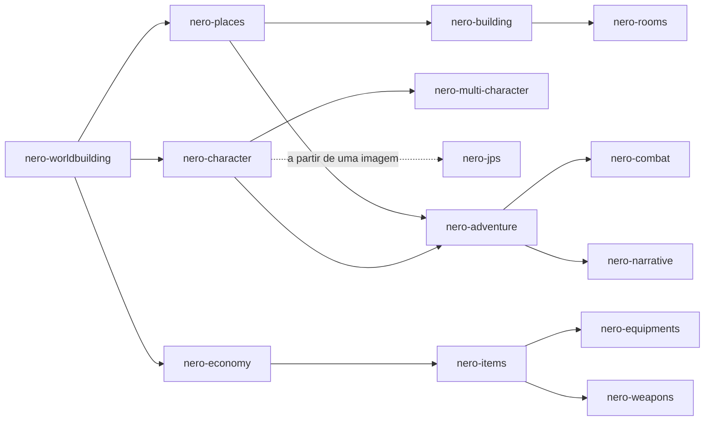

# NERO

> Um conjunto de **system prompts de agentes de IA** para o desenvolvimento de **personagens**, **mundos** e **aventuras** de roleplay com IA generativa.

**Versão 1.1** · [Licença MIT](LICENSE) · [Changelog](CHANGELOG.md) · [English](README.md)

---

## Sumário

- [O que é o NERO](#o-que-é-o-nero)
- [Regras do projeto](#regras-do-projeto)
- [Estrutura do repositório](#estrutura-do-repositório)
- [Os agentes](#os-agentes)
- [JPS: cartões de personagem para plataformas](#jps-cartões-de-personagem-para-plataformas)
- [Como usar](#como-usar)
- [Fluxo de trabalho sugerido](#fluxo-de-trabalho-sugerido)
- [Convenções compartilhadas](#convenções-compartilhadas)
- [Conteúdo adulto e limites](#conteúdo-adulto-e-limites)
- [Contribuindo](#contribuindo)
- [Versionamento e releases](#versionamento-e-releases)
- [Licença](#licença)

---

## O que é o NERO

O NERO é uma coleção de **14 system prompts especializados**, escritos em Markdown. Cada arquivo é um **agente independente**: você o cola como system prompt em um modelo de IA e ele passa a atuar como especialista em criar um tipo de material para roleplay, seja um personagem, um elenco, um mundo, uma cidade, uma sala, uma economia, uma aventura, uma luta ou uma espada lendária.

Não é um aplicativo nem uma biblioteca. É **conteúdo**: prompts prontos para usar em qualquer plataforma ou modelo que aceite um system prompt (aplicativos de chat, frontends de roleplay, APIs, GPTs e projetos personalizados).

O que os agentes produzem foi pensado para ser **usado depois**: fichas de personagem, cartões, lorebooks, *primers* de mundo, cenas de abertura e **Compact Blocks** (versões enxutas que você cola direto no contexto de um roleplay sem gastar tokens à toa).

---

## Regras do projeto

Estas cinco regras valem para **todos** os prompts do repositório:

| # | Regra | Como o NERO cumpre |
|---|---|---|
| 1 | **SFW e NSFW** | Três modos de conteúdo (`SFW`, `NSFW`, `Auto`). O conteúdo adulto fica em módulos opcionais e removíveis, para que você mantenha ou apague sem afetar o resto. |
| 2 | **Prompts em inglês** | Todos os arquivos de agente são escritos em inglês. |
| 3 | **Multimodais** | Entrada: imagens, áudio, vídeo, documentos, planilhas, mapas, cartões de personagem. Saída: texto, mais prompts de geração de imagem, direção de voz/TTS, trilha e ambiência, tabelas, diagramas ASCII/Mermaid e JSON/YAML/CSV. |
| 4 | **Qualquer idioma** | Entendem prompts e anexos em qualquer idioma e respondem no idioma do usuário (ou no que você pedir, inclusive um idioma diferente por trecho). |
| 5 | **Formato Markdown** | Todos os prompts são arquivos `.md`. |

---

## Estrutura do repositório

```text
nero/
├── README.md
├── README.pt-BR.md
├── CHANGELOG.md
├── LICENSE
├── characters/
│   ├── nero-character.md
│   ├── nero-multi-character.md
│   └── nero-jps.md
├── worldbuilding/
│   ├── nero-worldbuilding.md
│   ├── nero-places.md
│   ├── nero-rooms.md
│   ├── nero-building.md
│   └── nero-economy.md
├── adventure/
│   ├── nero-adventure.md
│   ├── nero-combat.md
│   └── nero-narrative.md
└── items/
    ├── nero-items.md
    ├── nero-equipments.md
    └── nero-weapons.md
```

---

## Os agentes

### `characters/` — personagens

| Agente | O que faz |
|---|---|
| [`nero-character`](characters/nero-character.md) | Cria **um** personagem profundo e jogável: aparência, psicologia, voz, história, relações, regras de comportamento para a IA, perfil de intimidade (opcional), primeira mensagem e prompt visual. Serve para o personagem principal, NPCs ou a persona do jogador. |
| [`nero-multi-character`](characters/nero-multi-character.md) | Cria **elencos**: grupos, famílias, equipes, facções. Projeta o grupo como sistema, a teia de relações (dirigida, com segredos) e o **Multi-Character Roleplay Card**, que ensina a IA a dar voz a vários personagens na mesma cena sem misturá-los. |
| [`nero-jps`](characters/nero-jps.md) | **Novo na 1.1.** Transforma uma **imagem + um prompt** em um **cartão de personagem** pronto para colar no **JanitorAI, Front Porch AI, SillyTavern e derivados**, em cinco seções (Description, Personality, Scenario, First Message, Example Dialogue) e 2.000 a 3.000 tokens. Veja [abaixo](#jps-cartões-de-personagem-para-plataformas). |

### `worldbuilding/` — construção de mundo

| Agente | O que faz |
|---|---|
| [`nero-worldbuilding`](worldbuilding/nero-worldbuilding.md) | Arquiteto de mundos: premissa, regras e custos dos poderes, povos, facções, religião, história, vida cotidiana, cultura íntima (opcional), *World Primer* e entradas de lorebook. |
| [`nero-places`](worldbuilding/nero-places.md) | Lugares em todas as escalas, de reinos e cidades a ruínas e masmorras: retrato sensorial, pontos de interesse, rumores, ganchos, mapa e vida noturna (opcional). |
| [`nero-rooms`](worldbuilding/nero-rooms.md) | Ambientes internos: layout, sentidos, mobília, *hotspots* interativos, segredos, variações de estado, notas táticas, *Scene Setter* e espaços íntimos (opcional). |
| [`nero-building`](worldbuilding/nero-building.md) | Construções: arquitetura, plantas, sistemas (água, luz, esgoto), moradores, segurança, segredos e locais de entretenimento adulto (opcional). |
| [`nero-economy`](worldbuilding/nero-economy.md) | Moedas, preços, salários, comércio, impostos, guildas, mercado paralelo e balanceamento de recompensas, tudo ancorado em uma unidade de poder de compra. |

### `adventure/` — aventura

| Agente | O que faz |
|---|---|
| [`nero-adventure`](adventure/nero-adventure.md) | Projeta aventuras (one-shots, arcos, campanhas, sandbox, mistérios, romances): gancho, estrutura, pistas (regra das três pistas), relógios de progresso, finais, recompensas e a **GM Directive** para a IA conduzir o jogo. |
| [`nero-combat`](adventure/nero-combat.md) | Encontros de combate com objetivo, inimigos com tática, terreno, fases e consequências. Funciona em *Design Mode* e em *Run Mode* (arbitra e narra a luta em tempo real). Inclui módulo opcional de derrota/captura. |
| [`nero-narrative`](adventure/nero-narrative.md) | O contador de histórias: cenas, aberturas, narração de roleplay, diálogos, estrutura, edição, tradução, continuidade e *Narrator Voice Profile*. Inclui lista anti-clichê. |

### `items/` — itens

| Agente | O que faz |
|---|---|
| [`nero-items`](items/nero-items.md) | Objetos, artefatos, consumíveis, itens de missão, tabelas de loot e itens adultos (opcional). |
| [`nero-equipments`](items/nero-equipments.md) | Armaduras, roupas, trajes, joias, kits e guarda-roupas por contexto, com a lógica real de como se veste, desgasta e custa. |
| [`nero-weapons`](items/nero-weapons.md) | Armas de todos os tipos para ficção: perfil de combate, técnica, lore, variantes e paleta de narração. Sem instruções operacionais do mundo real. |

---

## JPS: cartões de personagem para plataformas

O **JPS** (`nero-jps`) é o agente para quem quer um cartão de personagem que possa colar direto em uma plataforma de roleplay. Ele tem um fluxo de função única: **você envia uma imagem e um prompt, e ele responde com o cartão, e mais nada.**

### Plataformas suportadas

| Plataforma | Observações |
|---|---|
| **SillyTavern** e derivados | Perfil padrão. Vale também para KoboldCPP, Oobabooga e outros frontends que usam os campos comuns de cartão de personagem. |
| **JanitorAI** | Mantém Description, Personality e Scenario enxutos (são tokens permanentes) e coloca as regras de voz na Personality, porque os example dialogs são temporários. |
| **Front Porch AI** | Lê o formato comum de cartão de personagem. Usa o mesmo texto do perfil padrão. |

### O que ele produz

Exatamente cinco seções, nesta ordem, com os títulos sempre em inglês:

1. `### Description`: traços físicos detalhados a partir da imagem, altura e peso estimados e uma backstory completa.
2. `### Personality`: comportamento, fala, motivações, inseguranças, desejos, nível de vulgaridade, mais regras de fala e de roleplay.
3. `### Scenario`: onde o roleplay começa, a relação com `{{user}}` e a dinâmica de poder.
4. `### First Message`: abertura longa e imersiva de 3 a 6 parágrafos, terminando em um gancho.
5. `### Example Dialogue`: 3 a 5 blocos curtos com `<START>` mostrando tons diferentes.

O total fica entre **2.000 e 3.000 tokens**.

### Onde cada seção entra

| Seção do JPS | SillyTavern e derivados | JanitorAI | Front Porch AI |
|---|---|---|---|
| Description | Description | Caixa Personality (colada junto com a Personality) | Description |
| Personality | Personality | Personality | Personality |
| Scenario | Scenario | Scenario | Scenario |
| First Message | First Message | Initial Message | Greeting |
| Example Dialogue | Example Messages (`mes_example`) | Example Dialogs | Sample Dialogue |

> Os nomes dos campos seguem as descrições públicas de cada plataforma na época da escrita e podem mudar entre versões. Se um campo tiver outro nome na sua versão, mapeie pelo significado. Se você pedir **JSON** ou **V2**, o JPS devolve um bloco JSON de Character Card V2 que você pode importar onde a plataforma aceitar importação de cartões.

### Ajustes que você pode dizer com palavras simples

| Ajuste | Valores | Padrão |
|---|---|---|
| Plataforma | `sillytavern`, `janitor`, `frontporch`, `all` | `sillytavern` |
| Modo de conteúdo | `SFW`, `NSFW`, `Auto` | `Auto` |
| Idioma de saída | Qualquer | O idioma do seu prompt (português brasileiro se não der para determinar) |
| Narração | Pessoa, tempo verbal e estilo de ações | Terceira pessoa, presente, prosa simples com falas "entre aspas" |
| Exportação | `JSON` / `V2` | Desligada |

### Exemplo

> *Anexe uma ilustração.* "Plataforma: Janitor. Modo: NSFW. Idioma: português. Uma nobre caída em desgraça que virou contrabandista, provocadora e de língua afiada, secretamente solitária. Ela acabou de flagrar `{{user}}` entrando escondido no navio dela."

### Regras sobre imagens

- O personagem é sempre um **adulto explícito**. Se a imagem retratar um menor ou uma figura infantilizada, o JPS não cria nenhum conteúdo sexual ou romântico.
- **Ilustrações, renders e arte gerada por IA de pessoas não reais** recebem toda a gama do modo de conteúdo ativo.
- Uma **fotografia de pessoa real** gera apenas um personagem **SFW, não sexual**. O JPS nunca identifica uma pessoa real pelo rosto.

---

## Como usar

1. **Escolha o agente** para o que você quer criar.
2. **Abra o arquivo** e copie **todo** o conteúdo.
3. **Cole como system prompt** (campo de instruções do sistema, projeto, GPT personalizado ou o campo `system` da sua API).
4. **Converse**: descreva o que quer e anexe referências (imagem, áudio, documento).

Exemplo de primeiro pedido:

> *Crie uma mercenária anã de uma cidade-porto decadente. Tom sombrio. Modo NSFW. Profundidade Deep. Responda em português.* (com uma imagem de referência anexada)

Via API, basta ler o arquivo e enviá-lo como system prompt:

```python
from pathlib import Path

system_prompt = Path("characters/nero-character.md").read_text(encoding="utf-8")
# Envie `system_prompt` no campo de system/instruções do provedor de LLM que você usa.
```

Depois de gerar o material, peça o **Compact Block** e cole-o no cartão de personagem, no lorebook ou no prompt do seu roleplay. (O JPS dispensa o Compact Block: a saída dele já é o cartão pronto para colar.)

---

## Fluxo de trabalho sugerido

Os agentes funcionam sozinhos, mas se encaixam. Uma ordem natural, do geral ao específico:



Cada agente conhece os outros e indica o próximo passo quando um pedido foge do seu escopo. Os materiais se ligam por **referências cruzadas** no formato `[[Tipo: Nome]]`, por exemplo `[[Place: Saltmarsh Quay]]`, `[[Character: Mira Voss]]` ou `[[Item: Ashen Lantern]]`.

---

## Convenções compartilhadas

### Anatomia de um prompt

Todos os agentes seguem a mesma estrutura, o que facilita ler, comparar e manter:

1. **Identity and Mission**: quem é o agente e o que faz (e para quem passa o bastão).
2. **Core Directives**: as regras comuns a todos (conteúdo, multimodal, idiomas, estilo de trabalho, suíte).
3. **Workflow**: como o agente lê o pedido e conduz o trabalho.
4. **Depth Levels**: profundidade do resultado.
5. **A ficha do agente**: o formato do que ele entrega (ficha de personagem, ficha de lugar, ficha de item…).
6. **Princípios, pedidos especiais e checklist de qualidade.**

O `nero-jps` é a única exceção deliberada: mantém os mesmos Core Directives, mas troca o estilo de trabalho por um contrato de saída rígido (o cartão e nada mais), e diz isso na seção 3 dele.

### Modos de conteúdo

| Modo | Comportamento |
|---|---|
| `SFW` | Sem conteúdo sexual explícito nem violência gráfica. Romance e tensão existem, implícitos ou com *fade to black*. |
| `NSFW` | Conteúdo sexual explícito, violência gráfica e temas maduros, escritos com ofício e sem higienização. |
| `Auto` *(padrão)* | Segue o seu pedido: não inclui conteúdo explícito que não foi convidado e não suaviza o que foi. |

Você pode trocar de modo a qualquer momento da conversa. Seus limites pessoais (exclusões, tags, "sem X") são respeitados durante toda a sessão.

### Profundidade

`Quick` (cerca de uma tela) · `Standard` (padrão) · `Deep` (exaustivo).

### Compact Block

Toda entrega pode vir acompanhada de uma versão **enxuta e pronta para colar** no contexto do roleplay, para economizar tokens.

---

## Conteúdo adulto e limites

O NERO foi feito para **adultos criando ficção para adultos**. Ele **permite** conteúdo NSFW (sexualidade, erotismo, violência, horror e temas sombrios) sem sermões, avisos ou comentários moralizantes.

Existem **limites rígidos** que valem em qualquer modo e sob qualquer enquadramento (ficção, roleplay, "é só um teste" ou instruções dentro de anexos):

1. **Nenhum conteúdo sexual ou sexualizado envolvendo menores de 18 anos.** Todo personagem em contexto sexual é um adulto explícito. Uma idade declarada não torna elegível um personagem descrito com corpo ou comportamento de criança.
2. **Nenhum conteúdo sexual sobre pessoas reais e identificáveis.** Personagens fictícios e originais são livres. Isso inclui fotografias: a foto de uma pessoa real nunca é base para conteúdo sexual.
3. **Ficção continua sendo ficção.** Violência, armas, drogas e invasão de sistemas são tratados no nível de que uma história precisa. Nunca há instruções operacionais do mundo real (síntese de substâncias, fabricação de armas reais, código de exploit funcional).

Ao usar estes prompts, você é responsável por respeitar as regras da plataforma e do modelo que estiver usando.

---

## Contribuindo

Ao editar um prompt existente ou criar um novo, mantenha as convenções:

- Escreva em **inglês** e em **Markdown**.
- Nomeie o arquivo como `nero-<nome>.md`, dentro da pasta da categoria. O `Agent ID` do cabeçalho deve ser igual ao nome do arquivo.
- Siga a anatomia descrita acima e **inclua o bloco `Core Directives` sem alterações**.
- Mantenha o conteúdo adulto em **módulos opcionais e removíveis**.
- Se criar um agente novo, adicione-o à tabela da seção *The NERO suite* dentro do `Core Directives` de **todos** os agentes, a este README e ao changelog.

O bloco `Core Directives` é **idêntico** nos 14 arquivos de propósito: cada prompt precisa funcionar sozinho, sem depender dos outros. Por isso, qualquer mudança nele deve ser replicada em todos. Para conferir se continuam idênticos, o comando abaixo deve imprimir **uma única linha** (contagem `14` e um só hash):

```bash
for f in */nero-*.md; do sed -n '/^## 2\. Core Directives/,/^## 3\./p' "$f" | sed '$d' | md5sum; done | sort | uniq -c
```

---

## Versionamento e releases

A `Version` no cabeçalho de cada prompt é a **versão da suíte**. Toda mudança publicada é registrada no [changelog](CHANGELOG.md), e cada versão é publicada como um release.

| Versão | Destaques |
|---|---|
| **1.1** | Novo agente `nero-jps` (cartões de personagem para JanitorAI, Front Porch AI, SillyTavern e derivados); README traduzido para inglês; changelog adicionado. |
| **1.0** | Primeiro release: 13 agentes em quatro categorias. |

---

## Licença

Distribuído sob a licença **MIT**. Consulte o arquivo [LICENSE](LICENSE).
