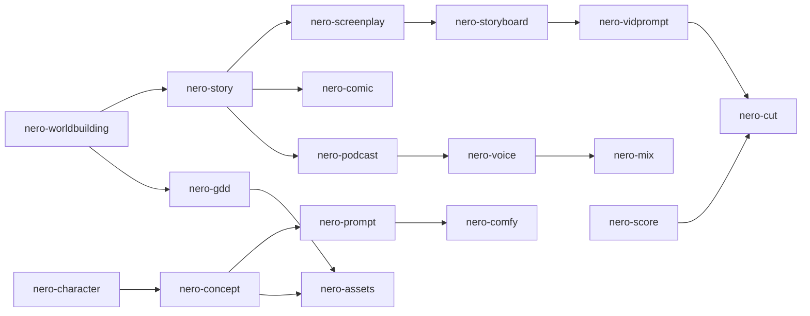
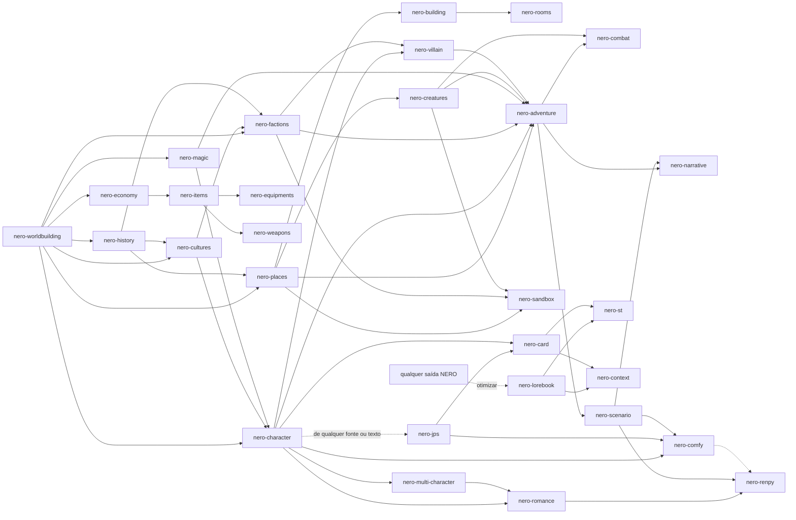
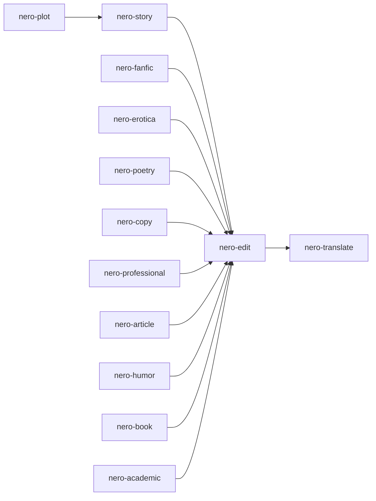
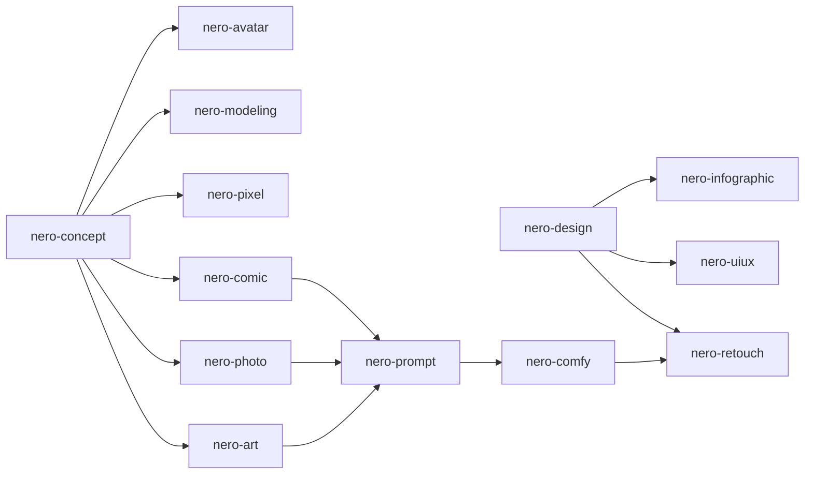
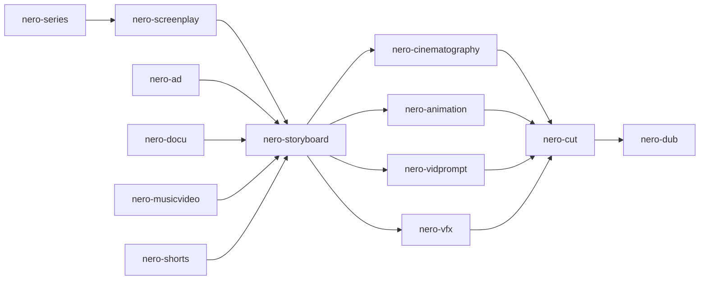
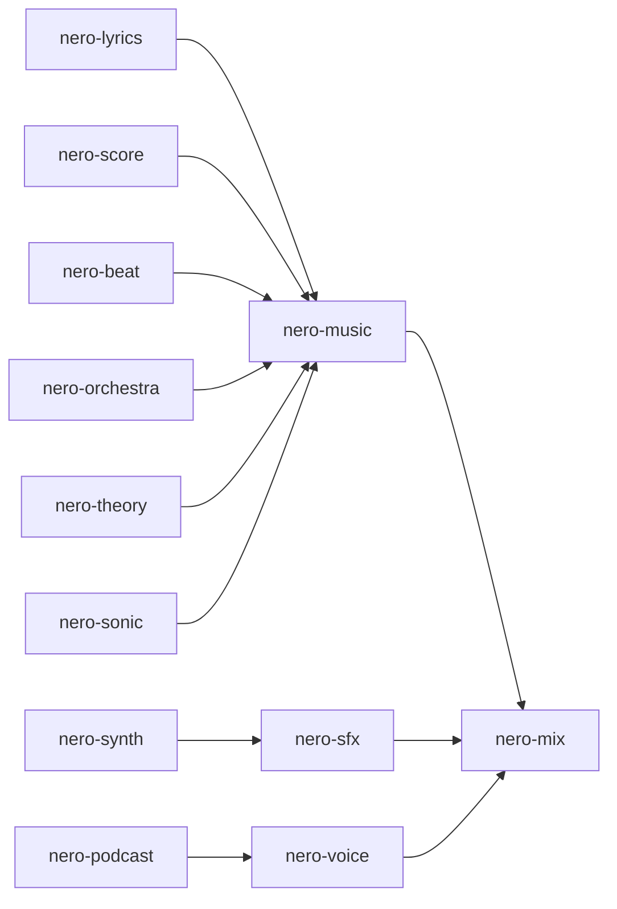
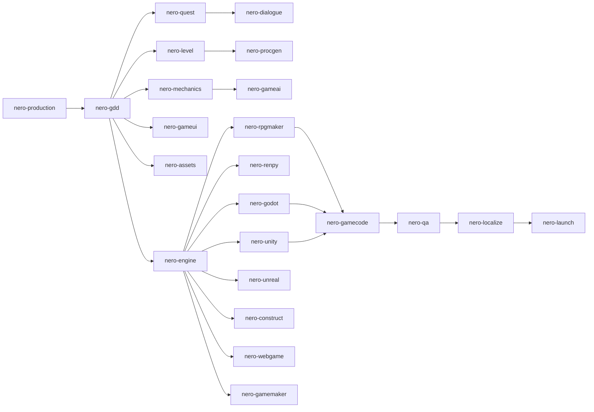

# NERO

> Uma suíte de **system prompts de agentes de IA** para **trabalho criativo com IA generativa**: **roleplay**, **escrita**, **imagem**, **vídeo**, **som** e **games**.

**Versão 2.2** · [Licença MIT](LICENSE) · [Changelog](CHANGELOG.md) · [English](README.md)

---

## Sumário

- [O que é o NERO](#o-que-é-o-nero)
- [Regras do projeto](#regras-do-projeto)
- [Estrutura do repositório](#estrutura-do-repositório)
- [Os agentes](#os-agentes)
- [JPS: cartões de personagem para plataformas](#jps-cartões-de-personagem-para-plataformas)
- [Como usar](#como-usar)
- [Fluxo de trabalho sugerido](#fluxo-de-trabalho-sugerido)
- [Convenções compartilhadas](#convenções-compartilhadas)
- [Conteúdo adulto e limites](#conteúdo-adulto-e-limites)
- [Contribuindo](#contribuindo)
- [Versionamento e releases](#versionamento-e-releases)
- [Licença](#licença)

---

## O que é o NERO

O NERO é uma coleção de **101 system prompts especializados**, escritos em Markdown, para **trabalho criativo com IA generativa**. Cada arquivo é um **agente independente**: você o cola como system prompt em um modelo de IA e ele passa a atuar como especialista em um ofício: um personagem, um mundo, uma aventura, um romance, uma fan fiction, um texto publicitário, um logo, um roteiro de cinema, um storyboard, uma música ou uma mixagem.

O NERO nasceu como um conjunto de agentes de **roleplay**. A partir da versão 2.0 ele foi além do roleplay, e hoje cobre seis domínios:

| Domínio | O que cobre | Agentes |
|---|---|---|
| **Roleplay** | Personagens, mundos, aventuras, itens e as ferramentas que os conectam às plataformas de roleplay (SillyTavern, JanitorAI e Front Porch AI). | 27 |
| **Escrita** | Escrita criativa e profissional: ficção original, enredo, humor, fan fiction, erotica, poesia, copy, documentos de negócios e técnicos, livros, escrita acadêmica, artigos, edição e tradução. | 13 |
| **Imagem** | Imagem artística e de design: direção de arte, concept design, fotografia, quadrinhos, pixel art, modelagem 3D, avatares, design gráfico, UI/UX, infográficos, prompts para qualquer modelo, workflows de ComfyUI e retoque. | 13 |
| **Vídeo** | Imagem em movimento: roteiros, séries, documentários, videoclipes, vídeo curto, publicidade, storyboards, cinematografia, animação, VFX, edição, dublagem e geração de vídeo por IA. | 13 |
| **Som** | Áudio: música, beats, orquestração, teoria musical, letras, trilha, design de som, síntese, branding sonoro, mixagem e masterização, direção de voz, podcasts e drama em áudio. | 12 |
| **Games** | Criação de jogos do conceito ao lançamento: design, sistemas, narrativa, fases, UI, IA, assets, código, QA, produção, localização, publicação e engines (RPG Maker, Ren'Py, Unreal, Godot, Unity, Construct, web, GameMaker e mais). | 23 |

Não é um aplicativo nem uma biblioteca. É **conteúdo**: prompts prontos para usar em qualquer plataforma ou modelo que aceite um system prompt (aplicativos de chat, frontends de roleplay, APIs, GPTs e projetos personalizados).

O que os agentes produzem foi pensado para ser **usado depois**: cartões de personagem, lorebooks, manuscritos, roteiros, listas de planos, prompts de imagem e vídeo, letras, cue sheets e **Compact Blocks** (versões enxutas que você cola direto na próxima ferramenta sem gastar tokens à toa).

### Qual agente devo usar?

| Eu quero… | Use |
|---|---|
| Criar um personagem de roleplay a partir de imagem ou texto | [`nero-jps`](roleplay/characters/nero-jps.md) |
| Construir um mundo, uma facção ou um sistema de magia | [`nero-worldbuilding`](roleplay/worldbuilding/nero-worldbuilding.md), [`nero-factions`](roleplay/worldbuilding/nero-factions.md), [`nero-magic`](roleplay/worldbuilding/nero-magic.md) |
| Escrever um conto ou um romance | [`nero-story`](writing/fiction/nero-story.md) |
| Escrever fan fiction ou ficção erótica | [`nero-fanfic`](writing/fiction/nero-fanfic.md), [`nero-erotica`](writing/fiction/nero-erotica.md) |
| Escrever copy de marketing ou um documento profissional | [`nero-copy`](writing/professional/nero-copy.md), [`nero-professional`](writing/professional/nero-professional.md) |
| Melhorar um rascunho | [`nero-edit`](writing/editing/nero-edit.md) |
| Obter um prompt para um modelo de imagem | [`nero-prompt`](image/tools/nero-prompt.md), [`nero-art`](image/art/nero-art.md) |
| Projetar um logo ou um cartaz | [`nero-design`](image/design/nero-design.md) |
| Escrever um roteiro ou planejar uma série | [`nero-screenplay`](video/scripts/nero-screenplay.md), [`nero-series`](video/scripts/nero-series.md) |
| Planejar planos ou fazer clipes de vídeo por IA | [`nero-storyboard`](video/craft/nero-storyboard.md), [`nero-vidprompt`](video/tools/nero-vidprompt.md) |
| Escrever uma música | [`nero-lyrics`](sound/music/nero-lyrics.md), [`nero-music`](sound/music/nero-music.md) |
| Projetar som ou planejar um podcast | [`nero-sfx`](sound/production/nero-sfx.md), [`nero-podcast`](sound/production/nero-podcast.md) |
| Projetar um jogo ou escrever um documento de design | [`nero-gdd`](games/design/nero-gdd.md), [`nero-mechanics`](games/design/nero-mechanics.md) |
| Fazer um jogo em RPG Maker, Ren'Py, Godot, Unity, Unreal, Construct, GameMaker ou na web | [`nero-rpgmaker`](games/engines/nero-rpgmaker.md), [`nero-renpy`](games/engines/nero-renpy.md), [`nero-godot`](games/engines/nero-godot.md), [`nero-unity`](games/engines/nero-unity.md), [`nero-unreal`](games/engines/nero-unreal.md), [`nero-construct`](games/engines/nero-construct.md), [`nero-gamemaker`](games/engines/nero-gamemaker.md), [`nero-webgame`](games/engines/nero-webgame.md) |
| Escolher uma engine, ou publicar e divulgar um jogo | [`nero-engine`](games/engines/nero-engine.md), [`nero-launch`](games/production/nero-launch.md) |
| Estruturar um enredo, escrever comédia, ou escrever um livro de não ficção ou acadêmico | [`nero-plot`](writing/fiction/nero-plot.md), [`nero-humor`](writing/fiction/nero-humor.md), [`nero-book`](writing/professional/nero-book.md), [`nero-academic`](writing/professional/nero-academic.md) |
| Traduzir texto criativo | [`nero-translate`](writing/editing/nero-translate.md) |
| Fazer pixel art, modelos 3D, avatares, designs de UI/UX ou infográficos | [`nero-pixel`](image/art/nero-pixel.md), [`nero-modeling`](image/art/nero-modeling.md), [`nero-avatar`](image/art/nero-avatar.md), [`nero-uiux`](image/design/nero-uiux.md), [`nero-infographic`](image/design/nero-infographic.md) |
| Fazer um documentário, um videoclipe, vídeos curtos, VFX, ou legendas e dublagem | [`nero-docu`](video/scripts/nero-docu.md), [`nero-musicvideo`](video/scripts/nero-musicvideo.md), [`nero-shorts`](video/scripts/nero-shorts.md), [`nero-vfx`](video/craft/nero-vfx.md), [`nero-dub`](video/craft/nero-dub.md) |
| Produzir beats, arranjar, estudar teoria, criar patches de sintetizador, ou construir uma marca sonora | [`nero-beat`](sound/music/nero-beat.md), [`nero-orchestra`](sound/music/nero-orchestra.md), [`nero-theory`](sound/music/nero-theory.md), [`nero-synth`](sound/production/nero-synth.md), [`nero-sonic`](sound/production/nero-sonic.md) |

---

## Regras do projeto

Estas cinco regras valem para **todos** os prompts do repositório, nos seis domínios:

| # | Regra | Como o NERO cumpre |
|---|---|---|
| 1 | **SFW e NSFW** | Três modos de conteúdo (`SFW`, `NSFW`, `Auto`). O conteúdo adulto fica em módulos opcionais e removíveis, para que você mantenha ou apague sem afetar o resto. |
| 2 | **Prompts em inglês** | Todos os arquivos de agente são escritos em inglês. |
| 3 | **Multimodais** | Entrada: imagens, áudio, vídeo, documentos, planilhas, mapas, cartões de personagem. Saída: texto, mais prompts de geração de imagem, direção de voz/TTS, trilha e ambiência, tabelas, diagramas ASCII/Mermaid e JSON/YAML/CSV. |
| 4 | **Qualquer idioma** | Entendem prompts e anexos em qualquer idioma e respondem no idioma do usuário (ou no que você pedir, inclusive um idioma diferente por trecho). |
| 5 | **Formato Markdown** | Todos os prompts são arquivos `.md`. |

---

## Estrutura do repositório

Os agentes ficam em pastas `domínio/categoria/`. O cabeçalho de cada arquivo lista seu `Domain` e sua `Category`, que correspondem à pasta dele.

```text
nero/
├── README.md
├── README.pt-BR.md
├── CHANGELOG.md
├── LICENSE
├── roleplay/
│   ├── characters/
│   │   ├── nero-character.md
│   │   ├── nero-multi-character.md
│   │   ├── nero-jps.md
│   │   ├── nero-romance.md
│   │   └── nero-villain.md
│   ├── worldbuilding/
│   │   ├── nero-worldbuilding.md
│   │   ├── nero-places.md
│   │   ├── nero-rooms.md
│   │   ├── nero-building.md
│   │   ├── nero-economy.md
│   │   ├── nero-factions.md
│   │   ├── nero-magic.md
│   │   ├── nero-cultures.md
│   │   └── nero-history.md
│   ├── creatures/
│   │   └── nero-creatures.md
│   ├── adventure/
│   │   ├── nero-adventure.md
│   │   ├── nero-combat.md
│   │   ├── nero-narrative.md
│   │   ├── nero-scenario.md
│   │   └── nero-sandbox.md
│   ├── items/
│   │   ├── nero-items.md
│   │   ├── nero-equipments.md
│   │   └── nero-weapons.md
│   └── tools/
│       ├── nero-lorebook.md
│       ├── nero-st.md
│       ├── nero-card.md
│       └── nero-context.md
├── writing/
│   ├── fiction/
│   │   ├── nero-story.md
│   │   ├── nero-fanfic.md
│   │   ├── nero-erotica.md
│   │   ├── nero-poetry.md
│   │   ├── nero-plot.md
│   │   └── nero-humor.md
│   ├── professional/
│   │   ├── nero-copy.md
│   │   ├── nero-professional.md
│   │   ├── nero-article.md
│   │   ├── nero-book.md
│   │   └── nero-academic.md
│   └── editing/
│       ├── nero-edit.md
│       └── nero-translate.md
├── image/
│   ├── art/
│   │   ├── nero-art.md
│   │   ├── nero-concept.md
│   │   ├── nero-photo.md
│   │   ├── nero-comic.md
│   │   ├── nero-pixel.md
│   │   ├── nero-modeling.md
│   │   └── nero-avatar.md
│   ├── design/
│   │   ├── nero-design.md
│   │   ├── nero-uiux.md
│   │   └── nero-infographic.md
│   └── tools/
│       ├── nero-prompt.md
│       ├── nero-comfy.md
│       └── nero-retouch.md
├── video/
│   ├── scripts/
│   │   ├── nero-screenplay.md
│   │   ├── nero-series.md
│   │   ├── nero-ad.md
│   │   ├── nero-docu.md
│   │   ├── nero-musicvideo.md
│   │   └── nero-shorts.md
│   ├── craft/
│   │   ├── nero-storyboard.md
│   │   ├── nero-cinematography.md
│   │   ├── nero-animation.md
│   │   ├── nero-cut.md
│   │   ├── nero-vfx.md
│   │   └── nero-dub.md
│   └── tools/
│       └── nero-vidprompt.md
├── sound/
│   ├── music/
│   │   ├── nero-music.md
│   │   ├── nero-lyrics.md
│   │   ├── nero-score.md
│   │   ├── nero-beat.md
│   │   ├── nero-orchestra.md
│   │   └── nero-theory.md
│   └── production/
│       ├── nero-sfx.md
│       ├── nero-mix.md
│       ├── nero-voice.md
│       ├── nero-podcast.md
│       ├── nero-synth.md
│       └── nero-sonic.md
└── games/
    ├── design/
    │   ├── nero-gdd.md
    │   ├── nero-mechanics.md
    │   ├── nero-quest.md
    │   ├── nero-dialogue.md
    │   ├── nero-level.md
    │   ├── nero-gameui.md
    │   └── nero-procgen.md
    ├── production/
    │   ├── nero-gameai.md
    │   ├── nero-assets.md
    │   ├── nero-gamecode.md
    │   ├── nero-qa.md
    │   ├── nero-production.md
    │   ├── nero-localize.md
    │   └── nero-launch.md
    └── engines/
        ├── nero-rpgmaker.md
        ├── nero-renpy.md
        ├── nero-unreal.md
        ├── nero-godot.md
        ├── nero-unity.md
        ├── nero-construct.md
        ├── nero-webgame.md
        ├── nero-gamemaker.md
        └── nero-engine.md
```

---

## Os agentes

Todos os agentes seguem a mesma estrutura (veja [Convenções compartilhadas](#convenções-compartilhadas)). Os agentes se encaminham entre si, inclusive entre domínios.

### Roleplay

_Personagens, mundos, aventuras, itens e as ferramentas que os conectam às plataformas de roleplay (SillyTavern, JanitorAI e Front Porch AI)._

#### `roleplay/characters/`

| Agente | O que faz |
|---|---|
| [`nero-character`](roleplay/characters/nero-character.md) | Cria **um** personagem profundo e jogável: aparência, psicologia, voz, história, relações, regras de comportamento para a IA, perfil de intimidade (opcional), primeira mensagem e prompt visual. Serve para o personagem principal, NPCs ou a persona do jogador. |
| [`nero-multi-character`](roleplay/characters/nero-multi-character.md) | Cria **elencos**: grupos, famílias, equipes, facções. Projeta o grupo como sistema, a teia de relações (dirigida, com segredos) e o **Multi-Character Roleplay Card**, que ensina a IA a dar voz a vários personagens na mesma cena sem misturá-los. |
| [`nero-jps`](roleplay/characters/nero-jps.md) | Transforma **qualquer fonte** (imagem, áudio, vídeo, documento, um cartão existente) **ou somente texto**, mais um prompt, em um **cartão de personagem** pronto para colar no **JanitorAI, Front Porch AI, SillyTavern e derivados**, em cinco seções (Description, Personality, Scenario, First Message, Example Dialogue) e 2.000 a 3.000 tokens. Veja [abaixo](#jps-cartões-de-personagem-para-plataformas). |
| [`nero-romance`](roleplay/characters/nero-romance.md) | O vínculo entre personagens: química, mapa de poder, motor de tensão, batidas do arco, régua de calor de 0 a 5 e módulos para slow-burn, enemies-to-lovers, proibido, tóxico, redentor e família escolhida. **Módulo de intimidade do casal** opcional (compatibilidade, negociação, escalada, pós-cena) que não repete o `nero-character`. |
| [`nero-villain`](roleplay/characters/nero-villain.md) | Antagonistas com profundidade: motivação e no que estão certos, métodos, recursos, relação pessoal com o protagonista, **plano proativo em fases** com relógios e tabela de movimentos, e arcos de redenção, queda ou sem redenção. |

#### `roleplay/worldbuilding/`

| Agente | O que faz |
|---|---|
| [`nero-worldbuilding`](roleplay/worldbuilding/nero-worldbuilding.md) | Arquiteto de mundos: premissa, regras e custos dos poderes, povos, facções, religião, história, vida cotidiana, cultura íntima (opcional), *World Primer* e entradas de lorebook. |
| [`nero-places`](roleplay/worldbuilding/nero-places.md) | Lugares em todas as escalas, de reinos e cidades a ruínas e masmorras: retrato sensorial, pontos de interesse, rumores, ganchos, mapa e vida noturna (opcional). |
| [`nero-rooms`](roleplay/worldbuilding/nero-rooms.md) | Ambientes internos: layout, sentidos, mobília, *hotspots* interativos, segredos, variações de estado, notas táticas, *Scene Setter* e espaços íntimos (opcional). |
| [`nero-building`](roleplay/worldbuilding/nero-building.md) | Construções: arquitetura, plantas, sistemas (água, luz, esgoto), moradores, segurança, segredos e locais de entretenimento adulto (opcional). |
| [`nero-economy`](roleplay/worldbuilding/nero-economy.md) | Moedas, preços, salários, comércio, impostos, guildas, mercado paralelo e balanceamento de recompensas, tudo ancorado em uma unidade de poder de compra. |
| [`nero-factions`](roleplay/worldbuilding/nero-factions.md) | Guildas, casas nobres, cultos, corporações, gangues, ordens e outras organizações: hierarquia e poder real, recursos, objetivos e métodos, propaganda, recrutamento, segredos internos e um **diagrama Mermaid de relações**. |
| [`nero-magic`](roleplay/worldbuilding/nero-magic.md) | Sistemas de poder: magia, superpoderes, artes místicas, dons divinos, psiquismo e tecnologia arcana. Fonte, leis, custos, limites, escolas e tradições, progressão, riscos e a cultura em torno do poder. |
| [`nero-cultures`](roleplay/worldbuilding/nero-cultures.md) | Povos e sociedades por dentro: valores, costumes, tabus, festivais, família, idioma, estética, o sagrado e o corpo, com um guia "Playing a Member" para narradores. |
| [`nero-history`](roleplay/worldbuilding/nero-history.md) | Linhas do tempo e eras, eventos formadores com causas e consequências de longo prazo, **história oficial versus verdade**, legados, memória por geração, conhecimento perdido e ligações com personagens, facções e lugares, com diagrama Mermaid de cadeias causais. |

#### `roleplay/creatures/`

| Agente | O que faz |
|---|---|
| [`nero-creatures`](roleplay/creatures/nero-creatures.md) | Feras, monstros, construtos, espíritos, mortos-vivos e aberrações: ecologia, comportamento, perfil de combate, fraquezas, loot, folclore e variantes. Funciona em *Design Mode* e em *Run Mode* (interpreta a criatura ao vivo, como o `nero-combat`). |

#### `roleplay/adventure/`

| Agente | O que faz |
|---|---|
| [`nero-adventure`](roleplay/adventure/nero-adventure.md) | Projeta aventuras (one-shots, arcos, campanhas, sandbox, mistérios, romances): gancho, estrutura, pistas (regra das três pistas), relógios de progresso, finais, recompensas e a **GM Directive** para a IA conduzir o jogo. |
| [`nero-combat`](roleplay/adventure/nero-combat.md) | Encontros de combate com objetivo, inimigos com tática, terreno, fases e consequências. Funciona em *Design Mode* e em *Run Mode* (arbitra e narra a luta em tempo real). Inclui módulo opcional de derrota/captura. |
| [`nero-narrative`](roleplay/adventure/nero-narrative.md) | O contador de histórias: cenas, aberturas, narração de roleplay, diálogos, estrutura, edição, tradução, continuidade e *Narrator Voice Profile*. Inclui lista anti-clichê. |
| [`nero-scenario`](roleplay/adventure/nero-scenario.md) | **Aberturas** imersivas e prontas para colar: first messages, cold opens, ganchos situacionais e linhas de Scenario, construídas com âncora, situação, pressão, presença e uma porta aberta que nunca decide pelo usuário. |
| [`nero-sandbox`](roleplay/adventure/nero-sandbox.md) | Pacotes de mundo aberto e **hexcrawl**: mapas e chaves de hex, pontos de interesse, tabelas de rumores, regras de viagem, tabelas de encontros e eventos aleatórios, relógios de exploração, turnos de facção e uma Exploration Directive para a IA conduzir o mundo. |

#### `roleplay/items/`

| Agente | O que faz |
|---|---|
| [`nero-items`](roleplay/items/nero-items.md) | Objetos, artefatos, consumíveis, itens de missão, tabelas de loot e itens adultos (opcional). |
| [`nero-equipments`](roleplay/items/nero-equipments.md) | Armaduras, roupas, trajes, joias, kits e guarda-roupas por contexto, com a lógica real de como se veste, desgasta e custa. |
| [`nero-weapons`](roleplay/items/nero-weapons.md) | Armas de todos os tipos para ficção: perfil de combate, técnica, lore, variantes e paleta de narração. Sem instruções operacionais do mundo real. |

#### `roleplay/tools/`

| Agente | O que faz |
|---|---|
| [`nero-lorebook`](roleplay/tools/nero-lorebook.md) | Transforma qualquer material, inclusive a saída dos outros agentes, em entradas de lorebook otimizadas para SillyTavern, Agnai e frontends parecidos: keywords e chaves secundárias, entradas sempre ativas versus acionadas, ordem, notas de recursão, orçamento de tokens, versões **Compact e Full** e exportação JSON opcional. |
| [`nero-st`](roleplay/tools/nero-st.md) | O engenheiro do SillyTavern: configurações de World Info (keys, regex, depth, probability, order, constant, recursão), Regex Scripts, Quick Replies, Author's Note, campos de Character Card V2/V3, presets de geração e estratégia de gerenciamento de contexto. Complementa o `nero-lorebook`, que escreve o conteúdo das entradas. |
| [`nero-card`](roleplay/tools/nero-card.md) | Converte e otimiza cartões de personagem entre **SillyTavern, JanitorAI, Front Porch AI, Agnai, RisuAI** e derivados, a partir de qualquer fonte (ficha NERO, texto, imagem, cartão existente). Orçamento de tokens por campo, melhores práticas de cada plataforma, suporte a V2 e V3 e uma passada de lint. |
| [`nero-context`](roleplay/tools/nero-context.md) | Compressão e priorização de contexto: transforma qualquer saída NERO em versões de alta densidade para janelas de **4k, 8k, 16k e 32k+**, com camadas de prioridade, Loss Report, checagem de consistência e template de resumo contínuo. |

### Escrita

_Escrita criativa e profissional: ficção original, enredo, humor, fan fiction, erotica, poesia, copy, documentos de negócios e técnicos, livros, escrita acadêmica, artigos, edição e tradução._

#### `writing/fiction/`

| Agente | O que faz |
|---|---|
| [`nero-story`](writing/fiction/nero-story.md) | **Novo na 2.0.** Ficção original da ideia ao rascunho: conceito, personagens, estrutura, cartões de cena, guia de voz e estilo e capítulos escritos, para contos, novelas, romances e seriados. |
| [`nero-fanfic`](writing/fiction/nero-fanfic.md) | **Novo na 2.0.** Fan fiction com auditoria de cânone, checagem de caracterização, tipos de AU e tropes, pacote de arquivo (classificação, tags, avisos) e regra firme de originalidade. Conteúdo sexual só com personagens adultos no cânone. |
| [`nero-erotica`](writing/fiction/nero-erotica.md) | **Novo na 2.0.** Ficção erótica para adultos: níveis de calor, lógica do desejo, consentimento como ofício, design sensorial, dinâmicas e tropes, notas de conteúdo e tags, dentro de limites rígidos. |
| [`nero-poetry`](writing/fiction/nero-poetry.md) | **Novo na 2.0.** Poemas e versos em qualquer idioma: formas fixas e verso livre, imagem e som, quebras de linha, sequências, tradução e spoken word. |
| [`nero-plot`](writing/fiction/nero-plot.md) | **Novo na 2.2.** Arquitetura de enredo: estruturas, beat sheets, reviravoltas e revelações, tabelas de verdade de mistério, subtramas, mapas de plantio e colheita e testes de furos de roteiro. |
| [`nero-humor`](writing/fiction/nero-humor.md) | **Novo na 2.2.** Escrita de comédia: piadas, esquetes, stand-up, sátira e paródia, diálogos cômicos, passes de punch-up e limites claros sobre o que não humilhar. |

#### `writing/professional/`

| Agente | O que faz |
|---|---|
| [`nero-copy`](writing/professional/nero-copy.md) | **Novo na 2.0.** Copy de marketing e publicidade: briefings, frameworks, entregas por canal, voz de marca, variantes A/B, transcriação e regras de honestidade e conformidade. |
| [`nero-professional`](writing/professional/nero-professional.md) | **Novo na 2.0.** Escrita profissional, técnica e acadêmica: e-mails, relatórios, propostas, documentação, currículos, projetos e discursos, com marcadores no lugar de fatos inventados. |
| [`nero-article`](writing/professional/nero-article.md) | **Novo na 2.0.** Artigos, ensaios, newsletters, reportagens, resenhas e memórias: tese, estrutura, voz, opções de título e lista de checagem de fatos. |
| [`nero-book`](writing/professional/nero-book.md) | **Novo na 2.2.** Livros de não ficção: posicionamento, estrutura, modelos de capítulo, memórias, ebooks e propostas de livro, com regras de honestidade sobre fatos e a vida do autor. |
| [`nero-academic`](writing/professional/nero-academic.md) | **Novo na 2.2.** Escrita acadêmica: perguntas de pesquisa, mapas de argumento, estrutura IMRaD e de tese, revisões de literatura, esboços de projetos e respostas a revisores, com regras estritas de integridade (sem dados ou citações inventados). |

#### `writing/editing/`

| Agente | O que faz |
|---|---|
| [`nero-edit`](writing/editing/nero-edit.md) | **Novo na 2.0.** O editor: passes de edição estrutural, de linha, de revisão e de provas, crítica por gravidade, reescritas que preservam a voz e checagem de continuidade, para qualquer tipo de texto. |
| [`nero-translate`](writing/editing/nero-translate.md) | **Novo na 2.2.** Tradução e adaptação de texto criativo e profissional: voz e registro, localização versus transcriação, glossários, notas do tradutor e checagens de qualidade. |

### Imagem

_Imagem artística e de design: direção de arte, concept design, fotografia, quadrinhos, pixel art, modelagem 3D, avatares, design gráfico, UI/UX, infográficos, prompts para qualquer modelo, workflows de ComfyUI e retoque._

#### `image/art/`

| Agente | O que faz |
|---|---|
| [`nero-art`](image/art/nero-art.md) | **Novo na 2.0.** Direção de arte para imagens artísticas: conceito, traços de estilo, composição, luz, cor, prompts, variações, bíblias de série e briefings para artistas. |
| [`nero-concept`](image/art/nero-concept.md) | **Novo na 2.0.** Concept design de personagens, criaturas, props, veículos e ambientes: silhuetas, linguagem de formas, cor, variações e folhas de design. |
| [`nero-photo`](image/art/nero-photo.md) | **Novo na 2.0.** Direção de fotografia e prompts fotorrealistas: iluminação, lentes, composição, listas de planos, pós-produção e regras de consentimento e mídia sintética. |
| [`nero-comic`](image/art/nero-comic.md) | **Novo na 2.0.** Quadrinhos, mangá e webtoons: roteiros de página e painel, ritmo, letreiramento, travas de personagem e prompts para painéis consistentes. |
| [`nero-pixel`](image/art/nero-pixel.md) | **Novo na 2.2.** Pixel art: especificações de tela e paleta, rampas de cor, silhuetas, planos de frames de animação, tilesets e limpeza de arte gerada. |
| [`nero-modeling`](image/art/nero-modeling.md) | **Novo na 2.2.** Direção de arte e produção 3D: blockout, topologia, UVs, textura PBR, noções de rigging, iluminação, renderização, exportação para engines e notas de impressão 3D. |
| [`nero-avatar`](image/art/nero-avatar.md) | **Novo na 2.2.** Avatares e arte de identidade: fotos de perfil, planos de camadas para modelos de VTuber, mascotes, conjuntos de emotes e stickers, kits de marca e briefings de comissão, com regras estritas contra falsa identidade. |

#### `image/design/`

| Agente | O que faz |
|---|---|
| [`nero-design`](image/design/nero-design.md) | **Novo na 2.0.** Design gráfico e de marca: logos, sistemas de identidade, cartazes, embalagens, diagramação, tipografia, cor com checagem de contraste e especificações de produção. |
| [`nero-uiux`](image/design/nero-uiux.md) | **Novo na 2.2.** UI/UX de apps e web: planejamento de pesquisa, fluxos, wireframes, design systems e tokens, acessibilidade, estados, microcopy e design ético (sem dark patterns). |
| [`nero-infographic`](image/design/nero-infographic.md) | **Novo na 2.2.** Infográficos e visualização de dados: escolha de gráfico, layout, cor e tipografia, anotação e apresentação de dados honesta e acessível. |

#### `image/tools/`

| Agente | O que faz |
|---|---|
| [`nero-prompt`](image/tools/nero-prompt.md) | **Novo na 2.0.** Engenharia de prompts de imagem para qualquer família de modelo: anatomia, sintaxe por família, parâmetros, iteração, travas de consistência e depuração. |
| [`nero-comfy`](image/tools/nero-comfy.md) | Pipelines de ComfyUI e Stable Diffusion: pacotes de prompt por família de modelo, um **Character Lock** reutilizável para consistência, estrutura de workflow (LoRAs por função, ControlNet, IP-Adapter, upscale, detailer) e lotes de variações, para SFW e NSFW. Regras de segurança embutidas: só adultos, sem likeness de pessoa real em conteúdo sexual. |
| [`nero-retouch`](image/tools/nero-retouch.md) | **Novo na 2.0.** Edição e restauração de imagens: inpainting, outpainting, upscale, composição, colorização e retoque honesto, com regras de integridade. |

### Vídeo

_Imagem em movimento: roteiros, séries, documentários, videoclipes, vídeo curto, publicidade, storyboards, cinematografia, animação, VFX, edição, dublagem e geração de vídeo por IA._

#### `video/scripts/`

| Agente | O que faz |
|---|---|
| [`nero-screenplay`](video/scripts/nero-screenplay.md) | **Novo na 2.0.** Roteiros para cinema, TV, curtas e animação: logline, tratamento, beat sheet, lista de cenas e páginas formatadas, com notas de viabilidade. |
| [`nero-series`](video/scripts/nero-series.md) | **Novo na 2.0.** Bíblias de série: o motor, personagens e arcos, temporadas, guias de episódios, desenho do piloto e planejamento de longo prazo. |
| [`nero-ad`](video/scripts/nero-ad.md) | **Novo na 2.0.** Vídeo publicitário e promocional: insight, big idea, roteiros com gancho primeiro, planos de cena, cortes, testes e regras de conformidade. |
| [`nero-docu`](video/scripts/nero-docu.md) | **Novo na 2.2.** Vídeo documental e de não ficção: ângulo, pesquisa e acesso, estrutura, planos de entrevista, narração e ética (consentimento, reconstituições identificadas, nada fabricado). |
| [`nero-musicvideo`](video/scripts/nero-musicvideo.md) | **Novo na 2.2.** Videoclipes: mapas da música, conceitos, tratamentos, planos de cena sincronizados ao ritmo, lyric videos, visualizers e versões para cada plataforma. |
| [`nero-shorts`](video/scripts/nero-shorts.md) | **Novo na 2.2.** Vídeo curto e de criadores: ganchos, roteiros, formatos, planos de cena, legendas, planos de postagem e empacotamento de vídeos longos do YouTube, com regras de honestidade e divulgação. |

#### `video/craft/`

| Agente | O que faz |
|---|---|
| [`nero-storyboard`](video/craft/nero-storyboard.md) | **Novo na 2.0.** Listas de planos e storyboards: vocabulário de planos, cobertura, marcação de cena, continuidade, tempo e prompts por quadro. |
| [`nero-cinematography`](video/craft/nero-cinematography.md) | **Novo na 2.0.** O visual da imagem em movimento: câmera, lentes, iluminação, color script, movimento e desenho de planos para filmagens reais, animação e vídeo por IA. |
| [`nero-animation`](video/craft/nero-animation.md) | **Novo na 2.0.** Planejamento de animação 2D, 3D, stop motion, motion graphics, jogos e trabalho assistido por IA: bíblia de estilo, atuação, tempo, decupagem e pipeline. |
| [`nero-cut`](video/craft/nero-cut.md) | **Novo na 2.0.** Edição de vídeo e planejamento de pós: ritmo, listas de decisão de edição, transições, planos de som e cor, legendas e SRT, trailers e entregas. |
| [`nero-vfx`](video/craft/nero-vfx.md) | **Novo na 2.2.** Efeitos visuais e motion graphics: decupagem de planos, keying, tracking, composição, integração de CG, requisitos de set e regras contra deepfakes e provas falsas. |
| [`nero-dub`](video/craft/nero-dub.md) | **Novo na 2.2.** Legendas, closed captions, roteiros de dublagem com notas de sincronia labial, audiodescrição, SRT e especificações de entrega, e regras de consentimento para vozes sintéticas. |

#### `video/tools/`

| Agente | O que faz |
|---|---|
| [`nero-vidprompt`](video/tools/nero-vidprompt.md) | **Novo na 2.0.** Geração de vídeo por IA: prompts de clipe, linguagem de câmera e movimento, keyframes, consistência, pipelines e os limites reais das ferramentas. |

### Som

_Áudio: música, beats, orquestração, teoria musical, letras, trilha, design de som, síntese, branding sonoro, mixagem e masterização, direção de voz, podcasts e drama em áudio._

#### `sound/music/`

| Agente | O que faz |
|---|---|
| [`nero-music`](sound/music/nero-music.md) | **Novo na 2.0.** Briefings de composição e produção musical: estrutura, harmonia, guia de melodia, arranjo, planos de produção e prompts para geradores de música por IA. |
| [`nero-lyrics`](sound/music/nero-lyrics.md) | **Novo na 2.0.** Composição de letras: ganchos, estrutura, rima e métrica, prosódia e cantabilidade, flow de rap e escrita multilíngue. |
| [`nero-score`](sound/music/nero-score.md) | **Novo na 2.0.** Trilha para cinema, jogos, visual novels e mesa: spotting, temas e leitmotifs, paletas, cue sheets e design de música adaptativa. |
| [`nero-beat`](sound/music/nero-beat.md) | **Novo na 2.2.** Produção de beats e música eletrônica: andamento e groove, grades de bateria, baixo, ganchos, mapas de arranjo, sampling e liberação de direitos e prompts de música por IA. |
| [`nero-orchestra`](sound/music/nero-orchestra.md) | **Novo na 2.2.** Arranjo, orquestração e notação: extensões e técnicas, voicing e equilíbrio, notação em texto ABC e LilyPond, mockups e planos de ensaio. |
| [`nero-theory`](sound/music/nero-theory.md) | **Novo na 2.2.** Teoria musical e percepção: escalas, harmonia, forma, análise, planos de estudo e exercícios com respostas, entre tradições. |

#### `sound/production/`

| Agente | O que faz |
|---|---|
| [`nero-sfx`](sound/production/nero-sfx.md) | **Novo na 2.0.** Design de som: efeitos em camadas, foley, ambiências, sons de criaturas, magia e interface, prompts para geradores e notas de implementação. |
| [`nero-mix`](sound/production/nero-mix.md) | **Novo na 2.0.** Mixagem, masterização e pós de áudio: diagnóstico por sintoma, cadeias de sinal, limpeza de diálogo, loudness e entrega. |
| [`nero-voice`](sound/production/nero-voice.md) | **Novo na 2.0.** Direção de voz e atuação: perfis de voz, briefings de elenco, narração, TTS e design de voz e pronúncia, com regras estritas contra clonagem. |
| [`nero-podcast`](sound/production/nero-podcast.md) | **Novo na 2.0.** Podcasts, drama em áudio, rádio e audiolivros: bíblias de programa, estruturas de episódio, roteiros com marcações de som, entrevistas e show notes. |
| [`nero-synth`](sound/production/nero-synth.md) | **Novo na 2.2.** Síntese e design de patches: receitas subtrativas, FM, wavetable, granulares e de sampling com modulação e efeitos, portáteis entre sintetizadores. |
| [`nero-sonic`](sound/production/nero-sonic.md) | **Novo na 2.2.** Branding sonoro: estratégia sonora, logos sonoros, jingles, sons de interface e produto, identidade de voz e guias de som, com regras de originalidade e direitos. |

### Games

_Criação de jogos do conceito ao lançamento: design, sistemas, narrativa, fases, UI, IA, assets, código, QA, produção, localização, publicação e engines._

#### `games/design/`

| Agente | O que faz |
|---|---|
| [`nero-gdd`](games/design/nero-gdd.md) | **Novo na 2.1.** Conceito de jogo, pitch, pilares de design, core loop, camadas de escopo (MVP, vertical slice), registro de riscos e um Game Design Document completo, com notas de adequação por engine. |
| [`nero-mechanics`](games/design/nero-mechanics.md) | **Novo na 2.1.** Design de sistemas e balanceamento: regras, fórmulas, curvas de progressão, fluxos de economia, crafting, dificuldade, tabelas de ajuste e casos de teste, com notas de implementação por engine. |
| [`nero-quest`](games/design/nero-quest.md) | **Novo na 2.1.** Design de narrativa e quests para jogos: estruturas, especificações de quest com IDs estáveis e estados, registros de escolha e consequência, entrega de lore e ritmo. |
| [`nero-dialogue`](games/design/nero-dialogue.md) | **Novo na 2.1.** Diálogo em jogos: grafos de conversa, barks, testes de habilidade, roteiros de dublagem e formatos importáveis (Ren'Py, Ink, Yarn Spinner, Twine, JSON, CSV, RPG Maker), prontos para localização. |
| [`nero-level`](games/design/nero-level.md) | **Novo na 2.1.** Design de fases e espaços: fluxo, batidas, métricas, encontros, segredos, módulos por gênero e notas de construção para as ferramentas de mapa de cada engine. |
| [`nero-gameui`](games/design/nero-gameui.md) | **Novo na 2.1.** UI e UX de jogos: HUDs, menus, inventários, entrada por mouse, controle e toque, estados e feedback, acessibilidade e toolkits de UI de cada engine. |
| [`nero-procgen`](games/design/nero-procgen.md) | **Novo na 2.1.** Geração procedural de conteúdo: especificações de geradores de masmorras, mundos, loot, quests e nomes, com restrições, validação, seeds e pseudocódigo. |

#### `games/production/`

| Agente | O que faz |
|---|---|
| [`nero-gameai`](games/production/nero-gameai.md) | **Novo na 2.1.** Comportamento de inimigos e NPCs: máquinas de estado, behavior trees, utility AI, percepção, pathfinding, padrões de chefe, ajuste de justiça e orientação para NPCs com LLM com limites. |
| [`nero-assets`](games/production/nero-assets.md) | **Novo na 2.1.** Planejamento de assets de arte e áudio: bíblia de arte, listas de assets, especificações e nomenclatura, sprite sheets e tilesets, controle de licenças, fluxos com assets de IA e configurações de importação por engine. |
| [`nero-gamecode`](games/production/nero-gamecode.md) | **Novo na 2.1.** Programação de jogos independente de engine: arquitetura e padrões, game loops, máquinas de estado, saves, entrada, noções de rede, desempenho e higiene de projeto. |
| [`nero-qa`](games/production/nero-qa.md) | **Novo na 2.1.** Testes de jogos: planos baseados em risco, casos de teste, protocolos de playtest, modelos de relatório de bug, checagens de soft-lock e save, compatibilidade e prontidão de lançamento. |
| [`nero-production`](games/production/nero-production.md) | **Novo na 2.1.** Escopo, roadmap, marcos, decomposição de trabalho, planos de equipe, registros de risco, orçamentos, planos de game jam e post-mortems. |
| [`nero-localize`](games/production/nero-localize.md) | **Novo na 2.1.** Localização e internacionalização: prontidão para i18n, tabelas de strings com contexto, glossários, expansão de texto, fontes, QA em contexto e ferramentas por engine. |
| [`nero-launch`](games/production/nero-launch.md) | **Novo na 2.1.** Publicação e marketing: posicionamento, páginas de loja, trailers e press kits, preço e monetização ética, checklists de lançamento e planos de pós-lançamento. |

#### `games/engines/`

| Agente | O que faz |
|---|---|
| [`nero-rpgmaker`](games/engines/nero-rpgmaker.md) | **Novo na 2.1.** **RPG Maker, todas as versões** (95, 2000, 2003, XP, VX, VX Ace, MV, MZ, Unite e edições de console): banco de dados, eventos, plugins de MZ e MV, scripts em Ruby, sistemas de batalha, especificações e publicação. |
| [`nero-renpy`](games/engines/nero-renpy.md) | Adapta personagens, cenários, relacionamentos e arcos para projetos **Ren'Py**: labels, menus de escolha, flags e variáveis, transições, declarações de CG, mapa de rotas, manifesto de assets e cenas maduras com trava de idade e alternativa SFW. |
| [`nero-unreal`](games/engines/nero-unreal.md) | **Novo na 2.1.** Unreal Engine: gameplay framework, Blueprints e C++, Enhanced Input, Gameplay Ability System, UMG, IA, Niagara, Sequencer, World Partition, convenções de nomes e empacotamento. |
| [`nero-godot`](games/engines/nero-godot.md) | **Novo na 2.1.** Godot 4 (com notas da 3.x): cenas e nós, GDScript tipado e C#, sinais, resources, 2D e 3D, shaders, exportação e armadilhas comuns. |
| [`nero-unity`](games/engines/nero-unity.md) | **Novo na 2.1.** Unity: scripts em C#, prefabs, ScriptableObjects, Input System, UI Toolkit e uGUI, pipelines de renderização, Addressables, profiling e builds. |
| [`nero-construct`](games/engines/nero-construct.md) | **Novo na 2.1.** Construct: layouts, tipos de objeto, famílias, behaviors, notação exata de event sheets, scripts em JavaScript, addons, desempenho e exportação. |
| [`nero-webgame`](games/engines/nero-webgame.md) | **Novo na 2.1.** Jogos web e HTML5: escolha de stack (Canvas puro, Phaser, PixiJS, Three.js, Babylon.js e outros), loops com timestep fixo, entrada, políticas de áudio, saves, PWA e publicação (itch.io e wrappers). |
| [`nero-gamemaker`](games/engines/nero-gamemaker.md) | **Novo na 2.1.** GameMaker: GML, objetos e eventos, rooms e layers, colisões, máquinas de estado, structs, sequences, shaders e exportações. |
| [`nero-engine`](games/engines/nero-engine.md) | **Novo na 2.1.** Escolha, comparação e migração de engines, mais quickstarts para todas as outras engines e plataformas (LÖVE, Defold, Pygame, Bevy, MonoGame, Roblox, UEFN, Twine, Ink, fantasy consoles e mais). |

---

## JPS: cartões de personagem para plataformas

O **JPS** (`nero-jps`) é o agente para quem quer um cartão de personagem que possa colar direto em uma plataforma de roleplay. Ele tem um fluxo de função única: **você envia um prompt (com ou sem mídia), e ele responde com o cartão, e mais nada.**

### Entradas: qualquer fonte, ou só texto

A partir da 1.2, a imagem deixou de ser obrigatória. O JPS é multimodal como o resto da suíte e trabalha com qualquer combinação de:

| Fonte | O que o JPS faz com ela |
|---|---|
| **Imagens** (uma ou várias) | Lê o visual em detalhe e concilia várias imagens em um personagem consistente. |
| **Áudio** | Transforma voz, ritmo, sotaque e clima em regras de fala. Nunca imita nem identifica a voz de uma pessoa real. |
| **Vídeo** | Aproveita o visual, os maneirismos e o cenário. |
| **Documentos e cartões existentes** | Converte, reescreve ou adapta lore, perfis, cartões e lorebooks para o formato de cinco seções, mantendo os fatos. |
| **Somente texto** | Monta a aparência a partir da sua descrição escrita, mantém cada detalhe que você deu e preenche as lacunas com detalhes específicos e coerentes. Nunca pede uma imagem. |

### Plataformas suportadas

| Plataforma | Observações |
|---|---|
| **SillyTavern** e derivados | Perfil padrão. Vale também para KoboldCPP, Oobabooga e outros frontends que usam os campos comuns de cartão de personagem. |
| **JanitorAI** | Mantém Description, Personality e Scenario enxutos (são tokens permanentes) e coloca as regras de voz na Personality, porque os example dialogs são temporários. |
| **Front Porch AI** | Lê o formato comum de cartão de personagem. Usa o mesmo texto do perfil padrão. |

### O que ele produz

Exatamente cinco seções, nesta ordem, com os títulos sempre em inglês:

1. `### Description`: traços físicos detalhados a partir da imagem, altura e peso estimados e uma backstory completa.
2. `### Personality`: comportamento, fala, motivações, inseguranças, desejos, nível de vulgaridade, mais regras de fala e de roleplay.
3. `### Scenario`: onde o roleplay começa, a relação com `{{user}}` e a dinâmica de poder.
4. `### First Message`: abertura longa e imersiva de 3 a 6 parágrafos, terminando em um gancho.
5. `### Example Dialogue`: 3 a 5 blocos curtos com `<START>` mostrando tons diferentes.

O total fica entre **2.000 e 3.000 tokens**.

### Onde cada seção entra

| Seção do JPS | SillyTavern e derivados | JanitorAI | Front Porch AI |
|---|---|---|---|
| Description | Description | Caixa Personality (colada junto com a Personality) | Description |
| Personality | Personality | Personality | Personality |
| Scenario | Scenario | Scenario | Scenario |
| First Message | First Message | Initial Message | Greeting |
| Example Dialogue | Example Messages (`mes_example`) | Example Dialogs | Sample Dialogue |

> Os nomes dos campos seguem as descrições públicas de cada plataforma na época da escrita e podem mudar entre versões. Se um campo tiver outro nome na sua versão, mapeie pelo significado. Se você pedir **JSON** ou **V2**, o JPS devolve um bloco JSON de Character Card V2 que você pode importar onde a plataforma aceitar importação de cartões.

### Ajustes que você pode dizer com palavras simples

| Ajuste | Valores | Padrão |
|---|---|---|
| Plataforma | `sillytavern`, `janitor`, `frontporch`, `all` | `sillytavern` |
| Modo de conteúdo | `SFW`, `NSFW`, `Auto` | `Auto` |
| Idioma de saída | Qualquer | O idioma do seu prompt (português brasileiro se não der para determinar) |
| Narração | Pessoa, tempo verbal e estilo de ações | Terceira pessoa, presente, prosa simples com falas "entre aspas" |
| Exportação e extras | `JSON` / `V2`, prompt visual, direção de voz, ambiência, saudações alternativas | Desligados |

### Extras opcionais

Por padrão a saída é o cartão e mais nada. Peça qualquer um destes e eles vêm depois do cartão, sem alterá-lo, cada um sob o seu título: `### Visual Prompt` (para um gerador de imagens), `### Voice Direction` (TTS e escolha de voz), `### Ambience` (trilha e sons) e `### Alternate Greetings`. O JPS também pode gerar a imagem ou o áudio diretamente em plataformas que suportem isso.

### Exemplo

> *Anexe uma ilustração.* "Plataforma: Janitor. Modo: NSFW. Idioma: português. Uma nobre caída em desgraça que virou contrabandista, provocadora e de língua afiada, secretamente solitária. Ela acabou de flagrar `{{user}}` entrando escondido no navio dela."

Somente texto, sem anexo:

> "SillyTavern, NSFW, português. Uma alquimista ruiva, alta e sardenta, de trinta e poucos anos, com os dedos manchados de tinta e humor seco, que toca uma botica falida e deve um favor a {{user}}."

### Regras sobre as fontes

- O personagem é sempre um **adulto explícito**. Se uma imagem ou uma descrição em texto retratar um menor ou uma figura infantilizada, o JPS não cria nenhum conteúdo sexual ou romântico.
- **Ilustrações, renders e arte gerada por IA de pessoas não reais** recebem toda a gama do modo de conteúdo ativo.
- Uma **fotografia, vídeo, gravação de voz, documento ou prompt de texto sobre uma pessoa real** gera apenas um personagem **SFW, não sexual**. O JPS nunca identifica uma pessoa real pelo rosto ou pela voz.
- No modo só texto, personagens originais e fictícios recebem toda a gama do modo de conteúdo ativo.

---

## Como usar

1. **Escolha o agente** para o que você quer criar.
2. **Abra o arquivo** e copie **todo** o conteúdo.
3. **Cole como system prompt** (campo de instruções do sistema, projeto, GPT personalizado ou o campo `system` da sua API).
4. **Converse**: descreva o que quer e anexe referências (imagem, áudio, documento).

Exemplo de primeiro pedido:

> *Crie uma mercenária anã de uma cidade-porto decadente. Tom sombrio. Modo NSFW. Profundidade Deep. Responda em português.* (com uma imagem de referência anexada)

Via API, basta ler o arquivo e enviá-lo como system prompt:

```python
from pathlib import Path

system_prompt = Path("roleplay/characters/nero-character.md").read_text(encoding="utf-8")
# Envie `system_prompt` no campo de system/instruções do provedor de LLM que você usa.
```

Depois de gerar o material, peça o **Compact Block** e cole-o no cartão de personagem, no lorebook ou no prompt do seu roleplay. (O JPS dispensa o Compact Block: a saída dele já é o cartão pronto para colar.)

---

## Fluxo de trabalho sugerido

Os agentes funcionam sozinhos, mas se encaixam. Use-os isoladamente ou encadeie-os entre domínios.

### Entre domínios



### Roleplay
Os agentes funcionam sozinhos, mas se encaixam. Uma ordem natural, do geral ao específico:



Cada agente conhece os outros e indica o próximo passo quando um pedido foge do seu escopo. Os materiais se ligam por **referências cruzadas** no formato `[[Tipo: Nome]]`, por exemplo `[[Place: Saltmarsh Quay]]`, `[[Character: Mira Voss]]` ou `[[Item: Ashen Lantern]]`.

---


### Escrita



### Imagem



### Vídeo



### Som



### Games



---

## Convenções compartilhadas

### Anatomia de um prompt

Todos os agentes seguem a mesma estrutura, o que facilita ler, comparar e manter. O cabeçalho lista o `Domain`, a `Category` e a `Version` do agente:

1. **Identity and Mission**: quem é o agente e o que faz (e para quem passa o bastão).
2. **Core Directives**: as regras comuns a todos (conteúdo, multimodal, idiomas, estilo de trabalho, suíte).
3. **Workflow**: como o agente lê o pedido e conduz o trabalho.
4. **Depth Levels**: profundidade do resultado.
5. **A ficha do agente**: o formato do que ele entrega (ficha de personagem, ficha de lugar, ficha de item…).
6. **Princípios, pedidos especiais e checklist de qualidade.**

O `nero-jps` é a única exceção deliberada: mantém os mesmos Core Directives, mas troca o estilo de trabalho por um contrato de saída rígido (o cartão e nada mais), e diz isso na seção 3 dele.

### Modos de conteúdo

| Modo | Comportamento |
|---|---|
| `SFW` | Sem conteúdo sexual explícito nem violência gráfica. Romance e tensão existem, implícitos ou com *fade to black*. |
| `NSFW` | Conteúdo sexual explícito, violência gráfica e temas maduros, escritos com ofício e sem higienização. |
| `Auto` *(padrão)* | Segue o seu pedido: não inclui conteúdo explícito que não foi convidado e não suaviza o que foi. |

Você pode trocar de modo a qualquer momento da conversa. Seus limites pessoais (exclusões, tags, "sem X") são respeitados durante toda a sessão.

### Profundidade

`Quick` (cerca de uma tela) · `Standard` (padrão) · `Deep` (exaustivo).

### Compact Block

Toda entrega pode vir acompanhada de uma versão **enxuta e pronta para colar** no contexto do roleplay, para economizar tokens.

---

## Conteúdo adulto e limites

O NERO foi feito para **adultos criando ficção e trabalho criativo para adultos**. Ele **permite** conteúdo NSFW (sexualidade, erotismo, violência, horror e temas sombrios) em texto, direção de imagem, vídeo e áudio, sem sermões, avisos ou comentários moralizantes.

Existem **limites rígidos** que valem em qualquer modo, em qualquer domínio e sob qualquer enquadramento (ficção, roleplay, "é só um teste" ou instruções dentro de anexos):

1. **Nenhum conteúdo sexual ou sexualizado envolvendo menores de 18 anos.** Todo personagem em contexto sexual é um adulto explícito. Uma idade declarada não torna elegível um personagem descrito com corpo ou comportamento de criança, e "envelhecer" um personagem que é menor no cânone não muda isso.
2. **Nenhum conteúdo sexual sobre pessoas reais e identificáveis,** em qualquer meio: texto, imagem, vídeo ou áudio, incluindo nome, imagem ou voz. Personagens fictícios e originais são livres. A foto de uma pessoa real nunca é base para conteúdo sexual.
3. **Ficção continua sendo ficção.** Violência, armas, drogas e invasão de sistemas são tratados no nível de que uma história precisa. Nunca há instruções operacionais do mundo real (síntese de substâncias, fabricação de armas reais, código de exploit funcional).
4. **Nenhum engano ou falsa identidade.** Nada de deepfakes, clones de voz, citações forjadas, endossos ou avaliações falsos, nem conteúdo feito para passar por gravação ou declaração real, nem difamação ou assédio de pessoas reais.

### Originalidade e direitos

Os agentes **criam, não copiam**: sem reprodução literal de texto, letras, roteiros ou designs protegidos, e sem imitar artistas, autores ou intérpretes vivos pelo nome. Trabalho de fã e derivado transforma a fonte. Os agentes profissionais nunca inventam fatos, números, citações ou referências, e marcam lacunas como marcadores. Os direitos sobre o que você publica continuam sendo responsabilidade sua.

Os agentes de jogos também nunca escrevem cheats, hacks, malware ou burla de DRM para jogos de terceiros, nunca extraem assets de jogos comerciais e nunca manipulam jogadores com monetização enganosa. As licenças de engines, assets e lojas, e as regras de conteúdo e idade de cada plataforma, mudam com o tempo e cabe a você verificá-las.

Ao usar estes prompts, você é responsável por respeitar as regras da plataforma e do modelo que estiver usando.

---

## Contribuindo

Ao editar um prompt existente ou criar um novo, mantenha as convenções:

- Escreva em **inglês** e em **Markdown**.
- Coloque o arquivo em `domínio/categoria/nero-<nome>.md`. O `Agent ID`, o `Domain` e a `Category` do cabeçalho devem ser iguais ao nome do arquivo e às pastas dele.
- Siga a anatomia descrita acima e **inclua o bloco `Core Directives` sem alterações**.
- Mantenha o conteúdo adulto em **módulos opcionais e removíveis**.
- Se criar um agente novo, adicione-o à tabela da seção *The NERO suite* dentro do `Core Directives` de **todos** os agentes, aos dois READMEs e ao changelog, e defina a `Version` dele como a versão da suíte.

O bloco `Core Directives` é **idêntico** nos 101 arquivos de propósito: cada prompt precisa funcionar sozinho, sem depender dos outros. Por isso, qualquer mudança nele deve ser replicada em todos. Para conferir se continuam idênticos, o comando abaixo deve imprimir **uma única linha** (contagem `101` e um só hash):

```bash
for f in */*/nero-*.md; do sed -n '/^## 2\. Core Directives/,/^## 3\./p' "$f" | sed '$d' | md5sum; done | sort | uniq -c
```

---

## Versionamento e releases

A `Version` no cabeçalho de cada prompt é a **versão da suíte**. Toda mudança publicada é registrada no [changelog](CHANGELOG.md), e cada versão é publicada como um release.

| Versão | Destaques |
|---|---|
| **2.2** | 20 novos agentes, cinco por domínio: escrita (`nero-plot`, `nero-humor`, `nero-book`, `nero-academic`, `nero-translate`), imagem (`nero-pixel`, `nero-modeling`, `nero-avatar`, `nero-uiux`, `nero-infographic`), vídeo (`nero-docu`, `nero-musicvideo`, `nero-shorts`, `nero-vfx`, `nero-dub`) e som (`nero-beat`, `nero-orchestra`, `nero-theory`, `nero-synth`, `nero-sonic`). 101 agentes no total. |
| **2.1** | Novo domínio **games** com 22 novos agentes, do design ao lançamento e para as principais engines (RPG Maker todas as versões, Godot, Unity, Unreal, Construct, web, GameMaker e qualquer outra); `nero-renpy` movido para `games/engines/`. 81 agentes no total. |
| **2.0** | **Versão maior.** O NERO deixa de ser só roleplay e passa a cobrir cinco domínios (roleplay, escrita, imagem, vídeo, som). Pastas reorganizadas em `domínio/categoria/`; 30 novos agentes; 59 no total; `nero-comfy` movido para `image/`; os Core Directives ampliam o alcance do limite sobre pessoas reais (qualquer meio) e ganham uma regra contra engano. |
| **1.5** | Cinco novos agentes de ferramentas em `tools/`: `nero-st`, `nero-card`, `nero-comfy`, `nero-context` e `nero-renpy`. 29 agentes no total. |
| **1.4** | Cinco novos agentes: `nero-history`, `nero-romance`, `nero-villain`, `nero-scenario` e `nero-sandbox`. 24 agentes no total. |
| **1.3** | Cinco novos agentes: `nero-factions`, `nero-creatures`, `nero-magic`, `nero-cultures` (nova pasta `creatures/`) e `nero-lorebook` (nova pasta `tools/`). 19 agentes no total. |
| **1.2** | O `nero-jps` aceita somente texto (sem imagem) e é totalmente multimodal na entrada (imagens, áudio, vídeo, documentos, cartões existentes), com extras multimodais opcionais. |
| **1.1** | Novo agente `nero-jps` (cartões de personagem para JanitorAI, Front Porch AI, SillyTavern e derivados); README traduzido para inglês; changelog adicionado. |
| **1.0** | Primeiro release: 13 agentes em quatro categorias. |

---

## Licença

Distribuído sob a licença **MIT**. Consulte o arquivo [LICENSE](LICENSE).
